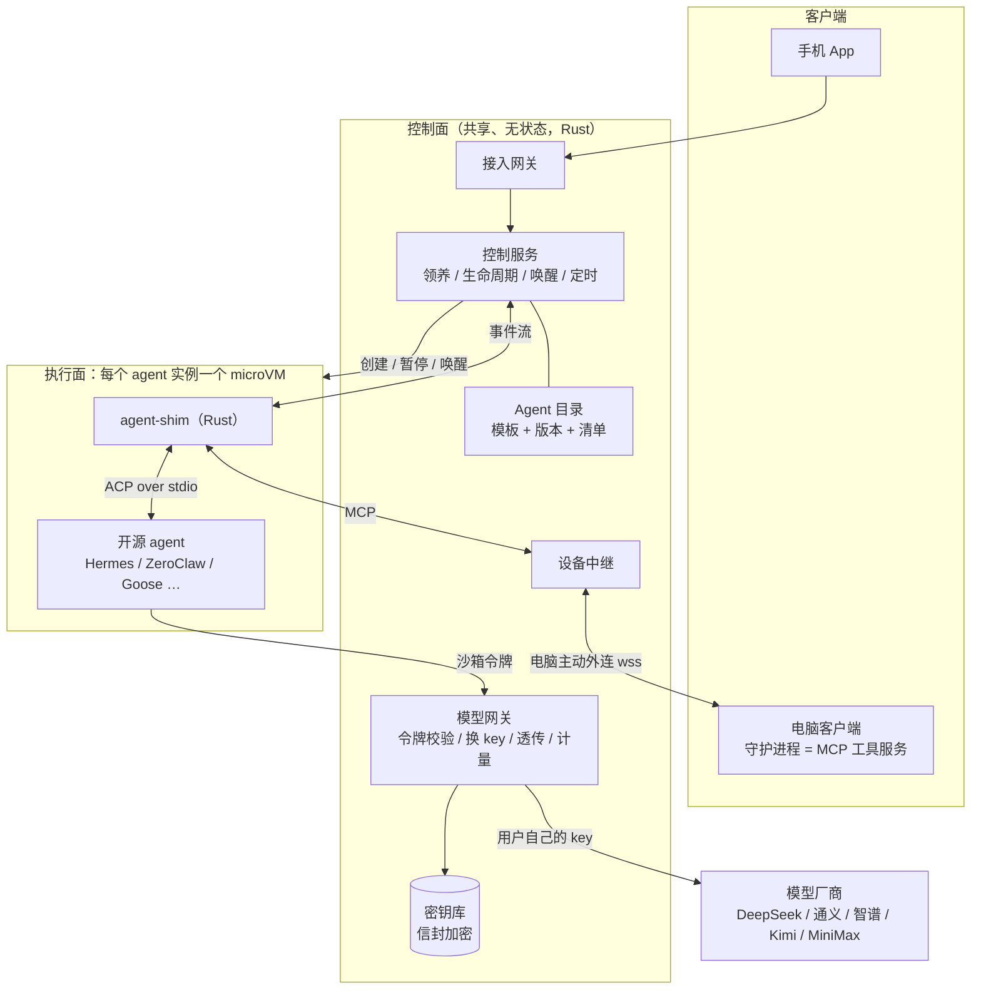
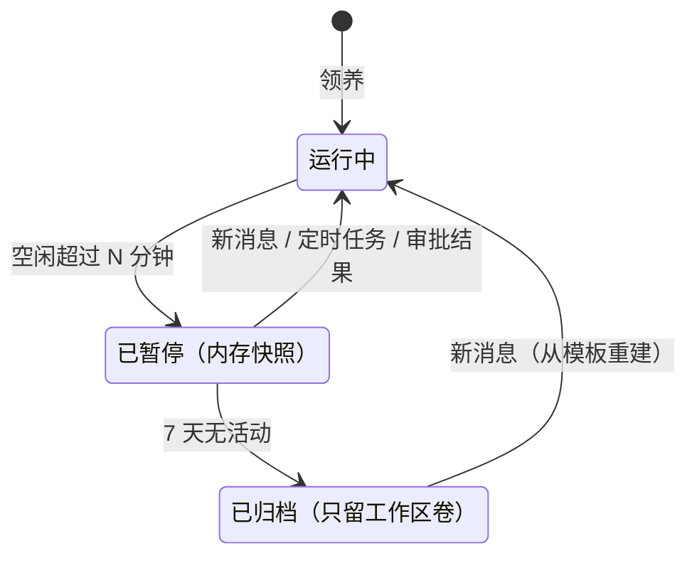
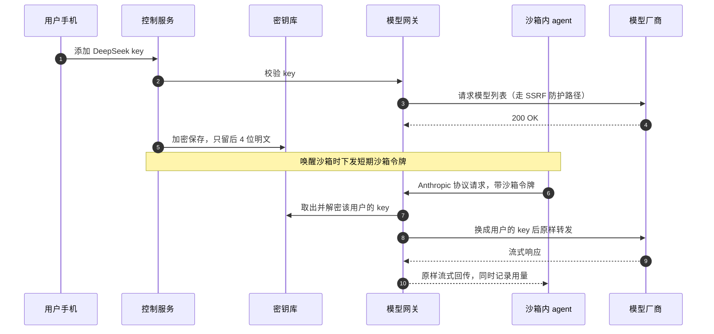

# ThinkTin 平台架构方案 v2

> 更新日期：2026-10-14　｜　状态：草案　｜　项目：thinktin-rust
>
> 本版汇总了 2026-10-14 讨论的全部结论，并加入两条新需求：
> 1. agent 不自研，全部采用开源 agent，云端部署多个；
> 2. 用户可以配置各厂商的 LLM key。
>
> 讨论过程见《ThinkTin 架构讨论记录（2026-10-14）》。

## 0. 结论

- **产品**：平台不自研 agent，只托管多个开源 agent。用户注册后"领养"一个或多个实例，每个实例跑在只属于他的 microVM 里。模型费用用他自己配置的厂商 key 支付（BYOK）。
- **隔离**：每个 agent 实例一个 microVM，首选 CubeSandbox。LLM key 等凭证永远不进沙箱，由平台的模型网关在转发请求时换上。
- **接入**：沙箱里放一个 Rust 写的 `agent-shim`，优先用 ACP（Agent Client Protocol）驱动各家 agent，再用 MCP 把平台工具和用户电脑的工具注入进去。手机端只对接一套统一接口。
- **成本**：用户自带 key 后，token 由用户直接付给厂商，平台的最大成本变成沙箱算力。用"逻辑常驻、物理按需"（空闲暂停、事件唤醒）来压低。
- **合规**：国内站只接入已备案的国内模型。OpenAI、Anthropic 对中国有访问限制，海外厂商只放在独立的海外站。

## 1. 需求与本版变化

| 需求 | 方案要点 |
|---|---|
| 平台发布多个 agent，用户领养后私用 | Agent 目录（模板 + 版本），领养即创建实例 |
| 用户之间强隔离 | 每个实例一个 microVM，凭证不进沙箱 |
| agent 全部用开源项目 | 不写 agent 循环，由 agent-shim 适配各家 agent |
| 可配置各厂商 LLM key | 密钥库 + 模型网关，按协议透传 |
| 手机安排云端 agent 干活 | 手机 → 控制面 → 唤醒沙箱 → agent |
| 手机让 agent 操作电脑 | 电脑守护进程作为 MCP 工具，经中继接给沙箱里的 agent |
| 用 Rust 开发 | 平台和客户端核心全部用 Rust；开源 agent 用什么语言写都行 |

**和 v1 相比的变化**

1. **取消"大脑共享"。** v1 设想自研 agent 循环，由多租户共享的大脑服务运行。现在每个开源 agent 都是完整的程序，整个跑在自己的 microVM 里。
2. **隔离粒度从"每用户一个沙箱"改为"每个 agent 实例一个沙箱"。** 不同 agent 的运行时差别很大（Node、Python、Rust），各用各的模板更简单。隔离边界仍然是用户：同一用户的实例之间可以共享一个工作区卷。
3. **新增四个模块**：Agent 目录、agent-shim、密钥库、模型网关。
4. **部署门槛降低。** CubeSandbox 现已支持 PVM 模式，可以跑在普通云主机上，代价是冷启动比裸金属慢三到四成。早期不必上裸金属。

## 2. 总体架构



- **控制面**（共享、无状态、可水平扩展，全部用 Rust）：接入网关、控制服务、Agent 目录、模型网关、密钥库、设备中继。数据放在 Postgres、Redis 和对象存储里。
- **执行面**（每个 agent 实例一个 microVM）：agent-shim、开源 agent 进程、工作区卷。
- **客户端**：手机 App；电脑客户端（图形界面 + 后台守护进程）。

三条主链路：

1. **手机下任务**：手机 → 接入网关 → 控制服务唤醒沙箱 → shim 用 ACP 把消息交给 agent。事件流（文字、工具调用、审批请求）原路回到手机；手机不在线时改走推送。
2. **调用模型**：agent 带着沙箱令牌请求模型网关 → 网关换成用户的 key 后转发给厂商 → 响应原样流式返回，同时记录用量。
3. **操作电脑**：agent 调用 shim 注入的 MCP 工具 → 设备中继 → 用户电脑的守护进程。高危操作要手机签名确认。

## 3. 开源 agent 托管

### 3.1 候选清单（2026-10）

| 类型 | Agent | 语言 | 许可证 | 接入方式 | 备注 |
|---|---|---|---|---|---|
| 常驻助理 | [Hermes Agent](https://github.com/NousResearch/hermes-agent)（Nous Research） | Python | MIT | ACP、MCP | GitHub 星标超过 25 万；自带记忆、技能、定时任务和多种 IM 网关 |
| 常驻助理 | [OpenClaw](https://docs.openclaw.ai/) | TypeScript（Node 24.16+） | MIT | ACP（`openclaw acp`）、自定义模型供应商 | 名气很大，但出过多起安全事件（见 3.6），技能市场必须关掉 |
| 常驻助理 | [ZeroClaw](https://github.com/zeroclaw-labs/zeroclaw) | Rust | MIT 或 Apache-2.0 | ACP、MCP | 单个二进制，号称内存不到 5MB；默认"监督"模式，高危操作需审批 |
| 常驻助理 | [IronClaw](https://github.com/nearai/ironclaw)（NEAR AI） | Rust | Apache-2.0 或 MIT | HTTP/WebSocket 网关、MCP | 工具跑在 WASM 沙箱，凭证在宿主边界注入；需要 PostgreSQL |
| 常驻助理 | [nanobot](https://github.com/HKUDS/nanobot)（港大 HKUDS） | Python | MIT | 未见 ACP 支持，需写适配器；支持 MCP | 轻量，支持飞书、微信等渠道 |
| 任务执行 | Goose（Block） | Rust | Apache-2.0 | ACP、MCP | 通用任务与编码 |
| 任务执行 | [OpenHands](https://github.com/OpenHands/OpenHands) | Python + TypeScript | MIT | ACP | 擅长编码，可每个会话一个容器 |
| 任务执行 | Codex CLI（OpenAI） | Rust | Apache-2.0 | ACP（经 codex-acp 适配器） | 可配置自定义模型供应商 |
| 任务执行 | [Kimi CLI](https://github.com/MoonshotAI/kimi-cli)（月之暗面） | Python | Apache-2.0 | ACP（`kimi acp`）、MCP | 国内厂商出品 |
| 任务执行 | Qwen Code（阿里） | TypeScript | Apache-2.0 | ACP | 对接 OpenAI 兼容接口 |

**首批建议上 3 个**：

- **Hermes Agent**：用户认知度高，ACP 和 MCP 都支持。
- **ZeroClaw**：Rust 写的，资源占用极小，适合做免费档。
- **Goose**：负责任务执行类场景。

OpenClaw 名气很大，但要先做完安全加固（见 3.6）再上架。

### 3.2 Agent 目录与模板

每个上架的 agent 在目录里是一个带版本的模板：

- **镜像**：基于上游某个发布版本构建的 Cube 沙箱模板，里面装好 agent 和 agent-shim。
- **清单（manifest）**：告诉 shim 怎么启动、怎么接入、配置写在哪、需要多少资源。
- **版本锁定**：用户实例锁定在某个模板版本上。升级时先在快照上试跑，失败可以回滚。
- **CI**：每个新版本用 ACP 跑一组固定的冒烟任务，通过后才能上架。

清单示例（命令和路径仅为示意，以上游文档为准）：

```toml
[agent]
id = "openclaw"
upstream = "https://github.com/openclaw/openclaw"
version = "2026.x.y"                    # 锁定上游发布版本
license = "MIT"

[runtime]
template = "agents/openclaw:2026.x.y"   # Cube 模板
vcpu = 1
memory_mb = 2048
state_dir = "/home/agent/.openclaw"     # 挂在实例的工作区卷上

[adapter]
kind = "acp"                            # acp | http | cli
command = ["openclaw", "acp"]           # 上游提供的 ACP 桥接

[llm]
protocols = ["openai-completions", "anthropic-messages"]
config = "openclaw-models"              # shim 内置的配置生成器：写 models.providers，baseUrl 指向模型网关

[policy]
skills_marketplace = false              # 关掉在线技能市场
self_update = false                     # 版本由平台控制
idle_pause_minutes = 10
heartbeat = "platform"                  # 心跳交给平台调度
```

### 3.3 agent-shim：沙箱里的 Rust 守护进程

1. **进程管理**：启动 agent、健康检查、崩溃重启；暂停前通知 agent 把状态落盘。
2. **协议适配**：对上用平台协议，经沙箱网络连到控制面；对下按清单用 ACP（stdio）、HTTP/WebSocket 或命令行驱动 agent。
3. **配置注入**：把用户的模型设置写成 agent 认识的格式。base URL 指向模型网关，key 填沙箱令牌。
4. **工具注入**：创建 ACP 会话时，把平台工具和电脑工具作为 MCP 服务器交给 agent。ACP 规定所有 agent 都必须支持 stdio 方式的 MCP，所以 shim 自带一个 stdio MCP 桥接程序。
5. **审批转发**：agent 发起的权限请求（ACP 的 `session/request_permission`）转给控制面，推送到手机，等用户决定。
6. **事件上报**：文字流、工具调用、用量、错误，统一成平台事件。

### 3.4 为什么选 ACP 做统一接入

- **覆盖面广**：ACP 是 Zed 发起的 agent 与客户端之间的协议（JSON-RPC）。官方列出的 agent 有四十多个，包括 OpenClaw、Hermes Agent、OpenHands、Goose、Kimi CLI、Qwen Code、Gemini CLI、OpenCode；Codex CLI 和 Claude Agent 通过适配器支持。
- **有官方 Rust SDK**：crate 名为 `agent-client-protocol`，shim 实现其中的 `Client` 端即可。
- **会话能力齐全**：`session/new` 可以传入 MCP 服务器列表；`session/load` 和 `session/resume` 能在沙箱唤醒后接回之前的会话。
- **局限**：目前只支持 stdio 传输，远程的 HTTP/WebSocket 传输还在 RFD 阶段（2026 年 7 月仍在推进）。所以 shim 必须和 agent 在同一个沙箱里，这恰好符合我们的结构。
- **暂未见 ACP 支持的 agent**（如 IronClaw、nanobot）：shim 走它们的 HTTP/WebSocket 接口，每个单独写适配器。

### 3.5 "常驻"怎么做：逻辑常驻、物理按需

开源助理类 agent 默认自己 7×24 在线：连着 IM 渠道、跑心跳、跑定时任务。每人一台常开的机器最省事，但也最贵。我们把需要一直在线的部分挪到控制面：

- **入口外置**：手机 App 的消息、IM 渠道的 webhook 都先到控制面，再唤醒沙箱转交给 agent。
- **定时外置**：agent 里的定时任务登记到平台调度器，到点唤醒沙箱执行。
- **心跳**：agent 自带的周期心跳（比如每半小时自检一次）会让沙箱几乎没法休眠，还会消耗用户的 token。默认关掉或调成很长的间隔，改用显式的定时任务。
- **状态**：agent 的状态目录放在实例的工作区卷上，暂停和归档都不会丢。



CubeSandbox 自带空闲自动暂停与恢复、快照，以及可插拔的存储卷。Rust 写的轻量 agent（如 ZeroClaw）号称启动不到 10 毫秒，从归档状态重建几乎无感。Node、Python 写的 agent 重启通常要几秒，更适合多停留在"已暂停"状态。

### 3.6 安全：把开源 agent 当成不可信程序

- **供应链**：2026 年 2 月，安全研究人员审计了 OpenClaw 技能市场 ClawHub 的 2857 个技能，其中 341 个是恶意的。平台默认关闭在线技能市场，只提供审核过的技能白名单。
- **不暴露 agent 自带的网关和控制台**：只允许沙箱内的 shim 通过本机回环地址访问。
- **禁止自更新**：版本由平台模板统一控制，安全补丁通过重建模板下发。
- **凭证不进沙箱**（见第 4 节）：即使 agent 被提示注入或装了恶意技能，也拿不到用户的 LLM key。
- **出网管控**：默认禁止访问内网和云元数据；出网策略按模板配置；模型流量只能走模型网关。
- **跟踪上游安全公告**：每个上架的 agent 指定负责人。出现高危漏洞时，要能在一天内重建模板、滚动升级。

### 3.7 许可证与商标

- MIT、Apache-2.0 允许商用托管，但要保留版权和许可证声明；Apache-2.0 还要保留 NOTICE 文件。
- AGPL 项目如果修改了代码再对外提供网络服务，需要公开修改后的源码，上架前单独评估。
- 有些热门项目用的不是开源许可证：n8n 的 Sustainable Use License 只允许内部业务、个人或非商业使用；Dify 的许可证规定未经书面授权不得做多租户服务。这类项目不能直接拿来托管。
- 用上游项目的名称和 logo 宣传前，先看对方的商标政策，别让用户误以为是官方服务。

## 4. 多厂商 LLM key（BYOK）

### 4.1 原则

1. **key 永不进沙箱。** 沙箱里只有短期的沙箱令牌，真实 key 只会短暂出现在模型网关的内存里。
2. **协议透传优先。** agent 说什么协议，就转发到厂商对应协议的接口。网关只换鉴权头，不改请求体。
3. **用户看得见、管得住。** key 可以增删改，能看用量，能设上限。

### 4.2 请求链路



### 4.3 厂商与协议

DeepSeek、通义、智谱、Kimi、MiniMax 都同时提供 OpenAI 兼容和 Anthropic 兼容接口，所以多数情况只需要透传：

| 厂商 | OpenAI 兼容 | Anthropic 兼容（Base URL） |
|---|---|---|
| DeepSeek | 有 | `https://api.deepseek.com/anthropic` |
| 阿里百炼（通义千问） | 有 | `https://dashscope.aliyuncs.com/apps/anthropic` |
| 智谱 GLM | 有 | `https://open.bigmodel.cn/api/anthropic` |
| Kimi（月之暗面） | `https://api.moonshot.cn/v1` | 有（Messages API） |
| MiniMax | 有 | `https://api.minimax.cn/anthropic` |
| 火山方舟、百度千帆、腾讯混元、硅基流动 | 有 | 待核实 |
| 自定义端点（vLLM、OneAPI 等） | 有 | — |
| OpenAI、Anthropic、Google | 各自原生协议 | 只在海外站开放（见第 9 节） |

- 地址以各厂商官方文档为准，接入时逐个验证。
- 各家兼容程度不一。比如 MiniMax 的 Anthropic 接口会忽略 `top_k`、`stop_sequences` 等参数，部分模型只支持文本。这类差异记在厂商适配表里。
- 配置界面只列出"agent 支持的协议"和"厂商提供的协议"有交集的组合。确实需要跨协议时（比如 agent 只会 Anthropic 协议，厂商只有 OpenAI 接口），再在网关里做协议转换，放到后期。

### 4.4 密钥存储

- **信封加密**：每个用户一把数据密钥（DEK），由云 KMS 的主密钥加密后存库。API key 用 DEK 做 AES-256-GCM 加密，密文和随机数存在 Postgres。
- **只显示后 4 位**：保存后永远不再返回明文，只能替换或删除。
- **明文只在网关内存里**：解密后只短时间缓存（比如 5 分钟），用 `secrecy` 包装、用 `zeroize` 清零。日志和链路追踪统一脱敏，绝不记录 Authorization 头。
- **注销即销毁**：删除用户的 DEK，所有密文都无法再解开。

### 4.5 模型路由

- 用户给每个实例配置"模型别名 → 凭证 + 上游模型"，比如 `main` 指向 DeepSeek 的旗舰模型，`fast` 指向通义的轻量模型。
- shim 生成 agent 配置时，把别名写成 agent 可选的模型名，base URL 指向网关，key 填沙箱令牌。
- 网关收到请求后，按"令牌 → 实例 → 别名"查出真实凭证和上游模型，再转发。
- 以后可以加降级链：主 key 限流或欠费时，自动切到备用 key。

### 4.6 防护

- **SSRF**：用户可以填自定义 base URL，这是最容易被忽略的漏洞。
    - 只允许 https。
    - 解析 DNS 后，拒绝内网、回环、链路本地和云元数据地址。
    - 连接时固定使用解析出的 IP，防止 DNS 重绑定；不跟随指向内网的重定向。
    - 网关出网走专用的出口代理。
- **沙箱令牌**：短期有效，绑定实例和沙箱的网络身份，每次唤醒都轮换。网关校验请求来源与令牌是否一致。
- **限额**：按 key、按天设预算；按任务限制最大步数；同一实例请求速率异常时熔断，防止 agent 死循环烧掉用户的钱。
- **校验**：保存 key 时调用一次厂商的模型列表接口，同样走 SSRF 防护路径。
- **审计**：记录 key 的增删改，以及每次调用的元数据（时间、实例、模型、token 数），不记录对话内容。

### 4.7 计量与平台额度

- **用量**从响应里取：Anthropic 协议的流式响应在 `message_start` 和 `message_delta` 事件里带 usage；OpenAI 兼容接口的流式响应需要开启 `stream_options.include_usage`。agent 没开时，网关可以替它补上，这是透传原则唯一的例外，要按厂商逐个验证。
- **平台额度**（可选）：没有 key 的用户用平台的 key，走同一条网关链路，按用量加价计费。此时 token 又变回平台成本，必须设额度上限。

### 4.8 网关自研还是用现成的

自研一个薄网关：用 axum 加 hyper（或 reqwest）做流式透传，核心逻辑就是鉴权、路由、换 key、计量，代码量不大，BYOK 的安全边界也掌握在自己手里。现成项目可以参考设计，但不要作为依赖。例如 Rust 写的 TensorZero 网关已在 2026 年 6 月 12 日归档。

## 5. 强隔离（更新）

| 层面 | 做法 |
|---|---|
| 计算 | 每个 agent 实例一个 microVM（CubeSandbox），独立内核，KVM 硬件隔离 |
| 网络 | 沙箱之间不通；禁止访问内网和云元数据；出网经出口网关按策略过滤；模型流量只走模型网关 |
| 数据 | 每个用户一把 DEK；工作区卷和快照按用户加密；对象存储按用户分前缀、只发临时凭证；Postgres 开 RLS 兜底 |
| 凭证 | LLM key、IM 渠道 token 都不进沙箱，由网关或出口代理在发请求时注入 |
| 控制面 | 路由目标（哪个沙箱、哪台电脑）只由会话绑定决定，不取自 agent 输出；数据库访问统一经过带 `TenantCtx` 的仓储层 |
| 企业版 | 独占物理核或专属宿主机，防 CPU 侧信道 |

沙箱选型沿用上一轮结论：CubeSandbox 优先，因为它完整、省资源，还兼容 E2B 接口。业务代码按 E2B 接口写，必要时可以换成底层同为 Firecracker 的 E2B。对比见附录 A。

## 6. 手机控制电脑

和 v1 相同，这里补上与开源 agent 的衔接：

- **连接**：电脑客户端的守护进程主动连出到设备中继（wss，走 443 端口），不开入站端口。它本质上是一个 MCP 工具服务。
- **衔接开源 agent**：shim 创建 ACP 会话时，把"我的电脑"作为一个 MCP 服务器交给 agent。任何支持 MCP 的 agent 都能用，不需要逐个适配。
- **配对**：设备各自生成密钥对，手机扫电脑上的二维码交换公钥，云端无法冒充任何一方。
- **权限**：普通操作用能力令牌限定目录、应用和有效期，可随时吊销。高危操作（删除、执行命令、发送、支付）要手机私钥签名，电脑本地验签通过才执行。
- **可见可控**：电脑上常驻"正在被控制"的提示，可一键停止，并保留本地审计日志。

## 7. 成本（更新）

| 成本项 | 谁承担 | 说明 |
|---|---|---|
| 模型 token | 用户（BYOK） | 用户直付厂商；平台代付额度单独收费 |
| 沙箱算力 | 平台 | 现在的最大头，靠按需启动压缩 |
| 存储 | 平台 | 工作区卷、暂停快照、模板 |
| 出网流量 | 平台 | 网页浏览、文件下载，按实例限速 |

**估算**（假设：1 万注册用户、日活 30%、每个日活用户的 agent 每天实际运行 20 分钟）：

- 平均并发 ≈ 10000 × 30% × 20 ÷ 1440 ≈ 42 个沙箱；按 4 倍峰值留余量，约 170 个。
- Node、Python 类 agent 按每个 2 GB 内存算，峰值约 340 GB；Rust 类按每个 512 MB 算，约 85 GB。两三台大内存服务器就能承载。
- 已暂停实例的内存快照大约等于它实际占用的内存。按 3000 个近期活跃实例算是 TB 级，放本地 NVMe；归档后只剩工作区卷。
- **对比**：国内云厂商的 OpenClaw 一键部署是每人一台轻量服务器或云主机，最低 2 核 2G 到 2 核 4G，每台每月约 50–155 元。1 万用户就是每月 50 万–155 万元。

**降本要点**：

- 空闲暂停、事件唤醒；关掉或拉长 agent 自带的心跳。
- 免费档优先放 Rust 写的轻量 agent（如 ZeroClaw），重型 agent 放付费档。
- 模板的只读层由所有实例共享，每个实例只存自己的增量；长期不活跃的实例只留工作区卷。
- 收费按"agent 档位 + 活跃时长"设计，平台代付额度单独计价。
- 防滥用：限制 CPU 时长和出网流量，注册时验证手机号。

## 8. Rust 技术栈与代码结构（更新）

```
thinktin-rust/
  crates/
    proto        共享协议与类型（平台 ↔ shim、平台 ↔ 客户端）
    gateway      接入网关（手机、电脑客户端）
    control      控制服务：领养、实例生命周期、暂停唤醒、定时任务
    catalog      Agent 目录：模板、版本、清单、许可证
    agent-shim   沙箱内守护进程：用 ACP/HTTP 驱动 agent，桥接 MCP
    llm-gw       模型网关：令牌校验、路由、换 key、流式透传、计量、限额
    keyvault     密钥库：信封加密、KMS 适配
    sandbox      沙箱抽象：Cube（E2B 兼容 REST 接口）、本地开发后端
    relay        设备中继
    desktop      电脑端守护进程（MCP 工具服务）
    client-core  客户端共享核心（Flutter 通过 flutter_rust_bridge 调用）
```

v1 的 `brain`（自研 agent 循环）已删除，职责拆给 `control` 和 `agent-shim`。

**主要依赖**：

- **服务端**：tokio、axum、tower、hyper/reqwest、rustls、sqlx（Postgres）、redis。
- **协议**：`agent-client-protocol`（ACP 官方 Rust SDK）、`rmcp`（MCP 官方 Rust SDK）。
- **安全**：`secrecy`、`zeroize`、`aes-gcm`（或 `aws-lc-rs`）、`biscuit-auth`（能力令牌）。
- **客户端**：Flutter + flutter_rust_bridge；电脑端用 enigo、xcap、chromiumoxide、keyring。

## 9. 合规

- **国内备案与登记**：截至 2026 年 6 月 30 日，全国已有 988 款生成式 AI 服务完成备案、598 款应用或功能完成登记。通过 API 调用已备案模型的应用，由地方网信办登记。用户自带 key 并不改变平台"向公众提供服务"的身份，所以国内站只开放已备案的国内模型。
- **AI 生成内容标识**：《人工智能生成合成内容标识办法》自 2025 年 9 月 1 日起施行，输出给用户的生成内容要按要求标识。同时要有内容安全审核和日志留存。
- **海外厂商的限制**：
    - OpenAI 自 2024 年 7 月 9 日起不再向中国内地提供 API 服务。
    - Anthropic 自 2025 年 9 月起禁止中国等国家的实体控股超过 50% 的企业使用其服务，不论企业注册在哪，也包括通过云平台使用。
    - 因此海外厂商只在由独立主体运营的海外站开放。
- **其他**：ICP 备案、等保、个人信息保护（注销时删除 DEK，满足删除要求）、开源许可证与商标（见 3.7）。

## 10. 路线图

1. **云端最小闭环**：上架 2–3 个 agent；完成 agent-shim（ACP）、模型网关和密钥库，先接 5 家国内厂商；手机端支持注册、领养、配置 key、对话和推送。
2. **常驻能力**：暂停与唤醒、定时任务外置、技能白名单、用量看板与限额；扩充 agent 目录。
3. **电脑端**：先上只读工具（看文件、截图），再开放操作类工具，最后上签名审批。
4. **渠道与商业化**：飞书、企业微信、钉钉等渠道；平台代付额度；海外站。

## 11. 竞品参照

- **国内云厂商一键部署 OpenClaw**：阿里云、腾讯云、火山引擎、百度智能云、京东云、华为云都有。形态是每人一台轻量服务器或云主机，最低 2 核 2G，每月约 50–155 元。
- **模型厂商的托管版**：MiniMax 的 MaxClaw 起价每月 19 美元另加用量额度；Kimi Claw 需要每月 39 美元起的会员档。两者都绑定自家模型。（数据来自竞品 MyClaw 的对比文章，未必中立。）

**我们的差异**：多个 agent 可选；不绑定模型厂商（BYOK）；手机能控制电脑；microVM 强隔离，加上按需启动带来的成本优势。

## 12. 待决问题

- 首批上架哪几个 agent？
- 是否提供平台代付额度？没有 key 的用户怎么上手？
- 国内站、海外站的运营主体和部署怎么安排？
- 同一用户的多个实例是否共享工作区？
- IM 渠道是否随首版上线？
- 电脑端是否也允许运行本地 agent？

## 附录 A：CubeSandbox 与 Firecracker

| 维度 | Firecracker | CubeSandbox |
|---|---|---|
| 定位 | 虚拟机监控器（"发动机"） | 完整的沙箱服务（"整车"） |
| 隔离 | KVM microVM，独立内核 | 同类技术，腾讯自研 CubeHypervisor |
| 成熟度 | 2018 年起投产，AWS Lambda 在用 | 2026 年 4 月开源，公开验证时间短 |
| 开箱即用 | 调度、网络、模板、快照管理、API 都要自建 | 自带 eBPF 网络隔离、出网网关、检查点 / 回滚 / 分叉、E2B 兼容接口 |
| 性能 | 裸启动约 125ms，单实例额外内存不到 5MB | 资源池 + 快照克隆，冷启动不到 60ms，额外内存不到 5MB |
| 部署 | 需要 KVM（裸金属或嵌套虚拟化） | 支持 PVM，可跑在普通云主机上（冷启动慢三到四成） |

**结论**：隔离强度打平；Firecracker 更成熟，Cube 更完整。本项目选 Cube，业务代码按 E2B 接口写，保留切换到 E2B（底层为 Firecracker）的退路。

## 附录 B：参考资料

**沙箱**

- [CubeSandbox（GitHub）](https://github.com/TencentCloud/CubeSandbox)
- [CubeSandbox 评测（DEV）](https://dev.to/andrew-ooo/cubesandbox-review-tencents-sub-60ms-ai-agent-sandbox-5ch2)
- [CubeSandbox 功能评估（OpenApps）](https://openapps.pro/apps/cubesandbox)
- [CubeSandbox 与 E2B 对比（WaveSpeed）](https://wavespeed.ai/blog/zh-CN/posts/cubesandbox-vs-e2b/)
- [AWS AgentCore Runtime 文档](https://docs.aws.amazon.com/bedrock-agentcore/latest/devguide/agents-tools-runtime.html)

**ACP 与开源 agent**

- [ACP 支持的 agent 列表](https://agentclientprotocol.com/overview/agents)
- [ACP Rust 库](https://agentclientprotocol.com/libraries/rust)
- [ACP 会话建立（session/new、session/load）](https://agentclientprotocol.com/protocol/v1/session-setup)
- [ACP 远程传输 RFD](https://agentclientprotocol.com/rfds/streamable-http-websocket-transport)
- [OpenClaw 是什么（Verdent）](https://www.verdent.ai/zh-CN/guides/openclaw/what-is-openclaw)
- [OpenClaw 自定义模型供应商](https://docs.openclaw.ai/gateway/config-tools/custom-providers)
- [OpenClaw 的 Node.js 版本要求](https://docs.openclaw.ai/install/node)
- [OpenClaw 安全指南（ClawHub 恶意技能）](https://www.bitdoze.com/openclaw-security-guide/)
- [OpenClaw 替代品（It's FOSS）](https://itsfoss.com/openclaw-alternatives/)
- [Hermes Agent](https://github.com/NousResearch/hermes-agent) · [ZeroClaw](https://github.com/zeroclaw-labs/zeroclaw) · [IronClaw](https://github.com/nearai/ironclaw) · [nanobot](https://github.com/HKUDS/nanobot) · [OpenHands](https://github.com/OpenHands/OpenHands) · [Kimi CLI](https://github.com/MoonshotAI/kimi-cli)

**模型厂商与网关**

- [Claude Code 接入国内模型的配置（菜鸟教程）](https://www.runoob.com/claude-code/claude-code-setup.html)
- [MiniMax Anthropic 兼容接口](https://platform.minimax.cn/docs/api-reference/text-anthropic-api)
- [Kimi 开放平台：获取 API Key](https://platform.kimi.com/docs/get-api-key)
- [TensorZero（已归档）](https://github.com/tensorzero/tensorzero)

**合规与竞品**

- [网信办备案与登记数据（光明网，2026-07-10）](https://m.gmw.cn/2026-07/10/content_1304528476.htm)
- [《人工智能生成合成内容标识办法》（国家网信办）](https://www.cac.gov.cn/2025-03/14/c_1743654685899683.htm)
- [Anthropic 限制中国等国家控股的企业（The Decoder）](https://the-decoder.com/anthropic-bans-companies-majority-controlled-by-china-russia-iran-and-north-korea-from-claude/)
- [OpenAI 对中国"停服"（澎湃新闻）](https://m.thepaper.cn/newsDetail_forward_27893141)
- [国内云厂商 OpenClaw 部署方案对比（CodePick）](https://codepick.dev/zh/practices/openclaw-cloud-deploy/)
- [MaxClaw 与 Kimi Claw 对比（MyClaw）](https://myclaw.ai/blog/maxclaw-vs-kimi-claw)
