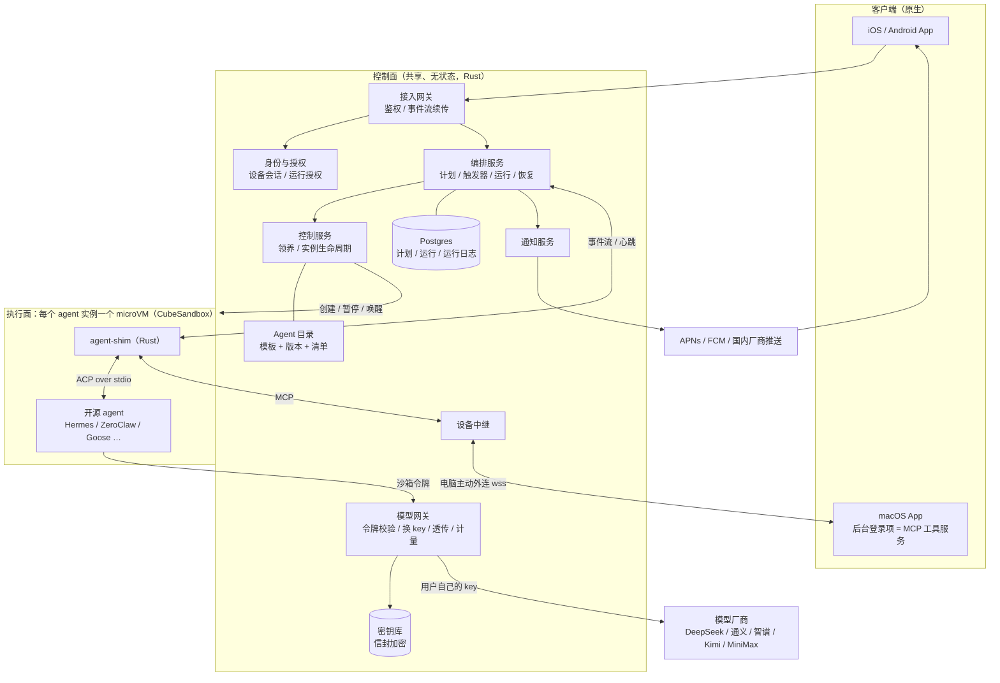
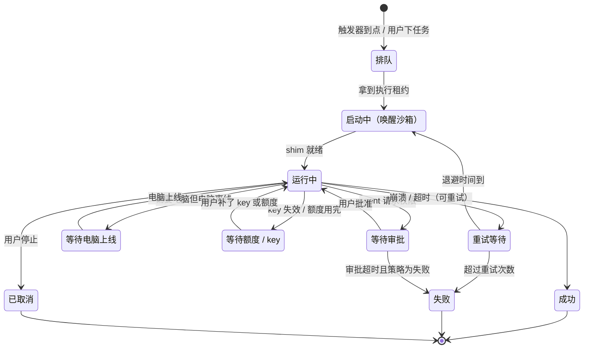
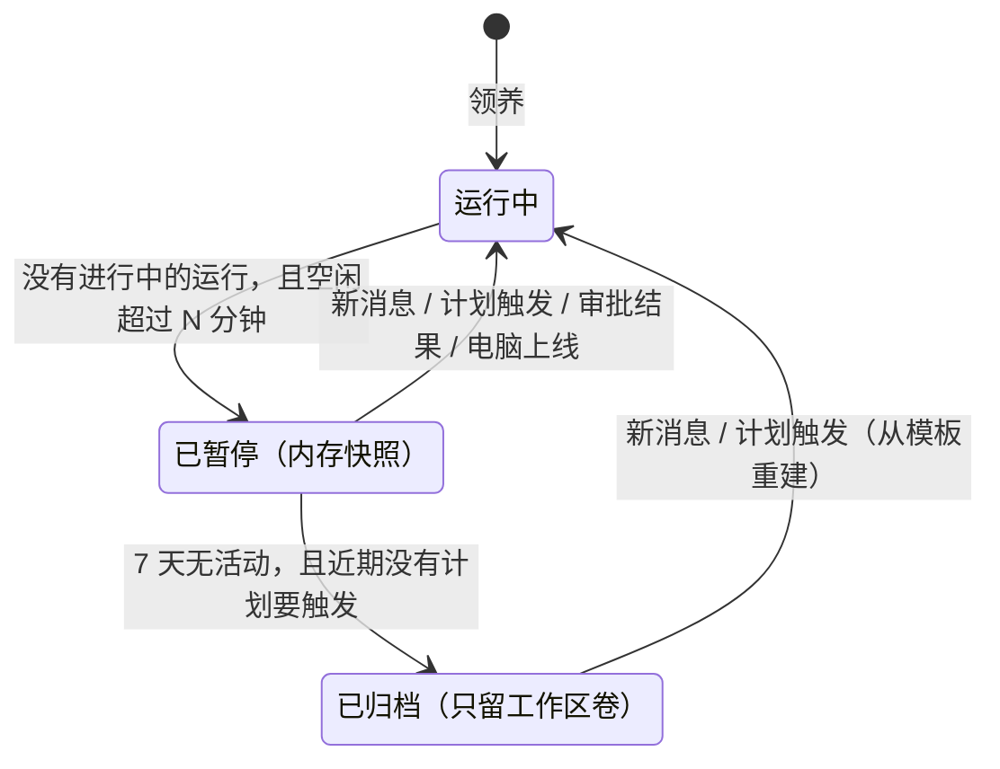
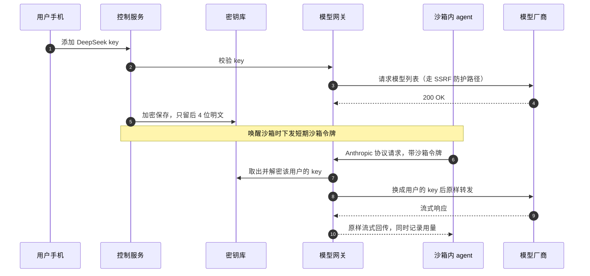
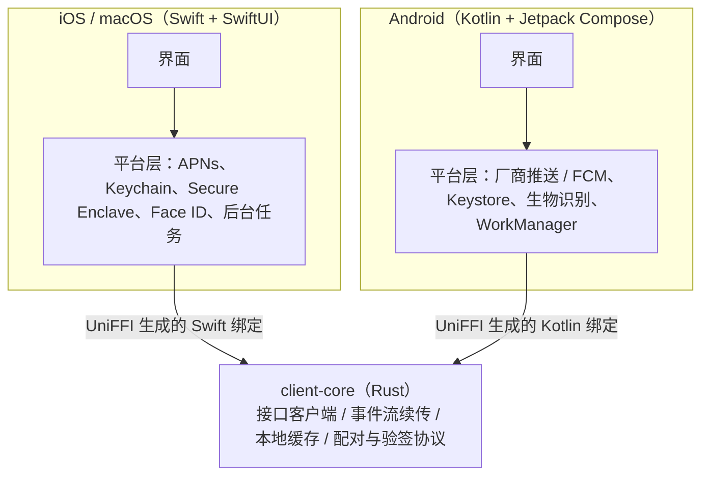

# ThinkTin 平台架构方案 v3

> 更新日期：2026-10-13　｜　状态：草案　｜　项目：thinktin-rust
>
> 本版在 v2 的基础上加入三条新要求：
> 1. **常驻 agent**：用户退出登录、关掉 App、手机离线，agent 的任务都不中断，还会按原定计划继续执行；
> 2. **多 agent 协同**：用户领养多个 agent 后，可以安排它们一起完成任务；
> 3. **三端原生开发**：iOS、Android、macOS 都用原生开发，不用 Flutter。
>
> v2 的结论（开源 agent 托管、BYOK、CubeSandbox 强隔离、全部用 Rust）全部保留。本版改动的章节标了“（v3）”，改动清单见附录 C。讨论过程见《ThinkTin 架构讨论记录（2026-10-14）》。

## 0. 结论

- **产品**：平台不自研 agent，只托管多个开源 agent。用户注册后"领养"一个或多个实例，每个实例跑在只属于他的 microVM 里。模型费用用他自己配置的厂商 key 支付（BYOK）。
- **多 agent 协同（v3）**：用户领养的多个 agent 可以组成团队，按用户编排的流水线或由负责人 agent 委派来协同工作。同一用户的 agent 之间**没有直接的网络连接**，但可以**经平台**查彼此的进度、读写共享看板、互相提问（不必在同一个团队）；文件经平台产出物传递（4.11）。**项目**：用户建项目、把 agent 安排进项目组（团队），别的用户也能把自己的 agent 派进来，跨用户只看得到项目里的工作（[项目与跨用户协作](projects.md)，设计中）。
- **常驻（v3）**：agent 的运行与用户的登录状态彻底解耦。“原定计划”由平台的**编排服务**持久化保存、按时触发、出错重试，不依赖手机在线，也不依赖 agent 进程一直活着。退出登录只注销这台设备，不会停掉 agent；要停 agent 必须显式操作。
- **隔离**：每个 agent 实例一个 microVM，选用腾讯开源的 CubeSandbox。LLM key 等凭证永远不进沙箱，由平台的模型网关在转发请求时换上。
- **接入**：沙箱里放一个 Rust 写的 `agent-shim`，优先用 ACP（Agent Client Protocol）驱动各家 agent，再用 MCP 把平台工具和用户电脑的工具注入进去。
- **客户端（v3）**：iOS 和 macOS 用 Swift + SwiftUI，Android 用 Kotlin + Jetpack Compose。三端共用一个 Rust 写的 `client-core`，通过 UniFFI 自动生成 Swift 和 Kotlin 绑定。
- **成本**：用户自带 key 后，token 由用户直接付给厂商，平台的最大成本变成沙箱算力。用"逻辑常驻、物理按需"（空闲暂停、事件唤醒）来压低。
- **合规**：国内站只接入已备案的国内模型。OpenAI、Anthropic 对中国有访问限制，海外厂商只放在独立的海外站。**2026-10-27 起步方案**：整套先部署在阿里云新加坡，所有模型厂商直连（含 OpenAI、Anthropic、xAI），暂不进国内应用商店、不做备案；以后要进国内商店再单独部署一套只接国内模型的国内版（[新加坡部署计划](deploy-aliyun-sg.md)）。

## 1. 需求与本版变化

| 需求 | 方案要点 |
|---|---|
| 平台发布多个 agent，用户领养后私用 | Agent 目录（模板 + 版本），领养即创建实例 |
| 用户之间强隔离 | 每个实例一个 microVM，凭证不进沙箱 |
| agent 全部用开源项目 | 不写 agent 循环，由 agent-shim 适配各家 agent |
| 可配置各厂商 LLM key | 密钥库 + 模型网关，按协议透传 |
| 手机安排云端 agent 干活 | 手机 → 控制面 → 唤醒沙箱 → agent |
| **常驻：退出登录后任务不中断、按原定计划继续（v3）** | 编排服务持久化计划与运行状态；运行授权与登录会话分离（第 4 节） |
| 手机让 agent 操作电脑 | 电脑守护进程作为 MCP 工具，经中继接给沙箱里的 agent |
| 用 Rust 开发 | 平台和客户端核心全部用 Rust；开源 agent 用什么语言写都行 |
| **多个 agent 协同工作（v3）** | 团队 + 运行树：流水线（用户编排）或委派（负责人 agent 分工），经平台产出物交换数据（4.11） |
| **iOS、Android、macOS 原生开发（v3）** | Swift/SwiftUI、Kotlin/Compose；共享逻辑放 Rust `client-core`，经 UniFFI 调用（第 8 节） |

**v3 相比 v2 的变化**

1. **新增编排服务 `orchestrator`**，负责计划、触发器、运行记录和恢复，是“常驻”的核心（第 4 节）。
2. **新增运行授权**：agent 干活用的凭证由平台签发、与用户登录会话无关；退出登录不影响，停用 agent 或注销账号才吊销（4.6）。
3. **客户端改为三端原生**，`client-core` 由 flutter_rust_bridge 改为 UniFFI；国内 Android 推送改走厂商通道（第 8 节）。
4. **新增 crate**：`orchestrator`、`auth`、`notify`、`store`、`server`（控制面模块化单体）；`desktop` 拆成 Rust 库加 macOS 原生壳（第 10 节）。
5. **多 agent 协同**：团队、流水线、委派和运行树，都由编排服务实现（4.11）。
6. **客户端事件流可续传**：手机离线期间产生的事件，重新上线后按序号补齐，不丢消息（4.8）。

**v2 相比 v1 的变化**

1. **取消"大脑共享"。** v1 设想自研 agent 循环，由多租户共享的大脑服务运行。现在每个开源 agent 都是完整的程序，整个跑在自己的 microVM 里。
2. **隔离粒度从"每用户一个沙箱"改为"每个 agent 实例一个沙箱"。** 不同 agent 的运行时差别很大（Node、Python、Rust），各用各的模板更简单。隔离边界仍然是用户：同一用户的实例之间可以共享一个工作区卷。
3. **新增四个模块**：Agent 目录、agent-shim、密钥库、模型网关。
4. **部署门槛降低。** CubeSandbox 现已支持 PVM 模式，可以跑在普通云主机上，代价是冷启动比裸金属慢三到四成。早期不必上裸金属。

## 2. 总体架构（v3）



- **控制面**（共享、无状态、可水平扩展，全部用 Rust）：接入网关、身份与授权、控制服务、编排服务、通知服务、Agent 目录、模型网关、密钥库、设备中继。数据放在 Postgres、Redis 和对象存储里。
- **执行面**（每个 agent 实例一个 microVM）：agent-shim、开源 agent 进程、工作区卷。
- **客户端**：iOS、Android、macOS 三端原生 App，共用 Rust 写的 `client-core`。

四条主链路：

1. **手机下任务**：手机 → 接入网关 → 编排服务生成一个运行 → 控制服务唤醒沙箱 → shim 用 ACP 把任务交给 agent。事件流写进运行日志，再推给在线的客户端；客户端不在线时，重要事件走系统推送。
2. **按计划自动执行（v3）**：编排服务在触发时间到达时生成运行，后面的流程和第 1 条相同，全程不需要手机在线或用户登录。
3. **调用模型**：agent 带着沙箱令牌请求模型网关 → 网关换成用户的 key 后转发给厂商 → 响应原样流式返回，同时记录用量。
4. **操作电脑**：agent 调用 shim 注入的 MCP 工具 → 设备中继 → 用户电脑上的 macOS App。高危操作要手机签名确认。

## 3. 开源 agent 托管

### 3.1 候选清单（2026-10）

| 类型 | Agent | 语言 | 许可证 | 接入方式 | 备注 |
|---|---|---|---|---|---|
| 常驻助理 | [Hermes Agent](https://github.com/NousResearch/hermes-agent)（Nous Research） | Python | MIT | ACP、MCP | GitHub 星标超过 25 万；自带记忆、技能、定时任务和多种 IM 网关 |
| 常驻助理 | [OpenClaw](https://docs.openclaw.ai/) | TypeScript（Node 24.16+） | MIT | ACP（`openclaw acp`）、自定义模型供应商 | 名气很大，但出过多起安全事件（见 3.6），技能市场必须关掉 |
| 常驻助理 | [ZeroClaw](https://github.com/zeroclaw-labs/zeroclaw) | Rust | MIT 或 Apache-2.0 | ACP、MCP | 单个二进制，号称内存不到 5MB；默认"监督"模式，高危操作需审批 |
| 常驻助理 | [IronClaw](https://github.com/nearai/ironclaw)（NEAR AI） | Rust | Apache-2.0 或 MIT | HTTP/WebSocket 网关、MCP | 工具跑在 WASM 沙箱，凭证在宿主边界注入；需要 PostgreSQL |
| 常驻助理 | [nanobot](https://github.com/HKUDS/nanobot)（港大 HKUDS） | Python | MIT | 未见 ACP 支持，需写适配器；支持 MCP | 轻量，支持飞书、微信等渠道 |
| 任务执行 | Goose（Block） | Rust | Apache-2.0 | ACP、MCP | 通用任务与编码 |
| 任务执行 | [OpenHands](https://github.com/OpenHands/OpenHands) | Python + TypeScript | MIT | ACP | 擅长编码，可每个会话一个容器 |
| 任务执行 | Codex CLI（OpenAI） | Rust | Apache-2.0 | ACP（经 codex-acp 适配器） | 可配置自定义模型供应商 |
| 任务执行 | [Kimi CLI](https://github.com/MoonshotAI/kimi-cli)（月之暗面） | Python | Apache-2.0 | ACP（`kimi acp`）、MCP | 国内厂商出品 |
| 任务执行 | Qwen Code（阿里） | TypeScript | Apache-2.0 | ACP | 对接 OpenAI 兼容接口 |

**首批建议上 3 个**：

- **Hermes Agent**：用户认知度高，ACP 和 MCP 都支持。
- **ZeroClaw**：Rust 写的，资源占用极小，适合做免费档。
- **Goose**：负责任务执行类场景。

OpenClaw 名气很大，但要先做完安全加固（见 3.6）再上架。

### 3.2 Agent 目录与模板

每个上架的 agent 在目录里是一个带版本的模板：

- **镜像**：基于上游某个发布版本构建的 Cube 沙箱模板，里面装好 agent 和 agent-shim。
- **清单（manifest）**：告诉 shim 怎么启动、怎么接入、配置写在哪、需要多少资源。
- **版本锁定**：用户实例锁定在某个模板版本上。升级时先在快照上试跑，失败可以回滚。
- **CI**：每个新版本用 ACP 跑一组固定的冒烟任务，通过后才能上架。

清单示例（命令和路径仅为示意，以上游文档为准）：

```toml
[agent]
id = "openclaw"
upstream = "https://github.com/openclaw/openclaw"
version = "2026.x.y"                    # 锁定上游发布版本
license = "MIT"

[runtime]
template = "agents/openclaw:2026.x.y"   # Cube 模板
vcpu = 1
memory_mb = 2048
state_dir = "/home/agent/.openclaw"     # 挂在实例的工作区卷上

[adapter]
kind = "acp"                            # acp | http | cli
command = ["openclaw", "acp"]           # 上游提供的 ACP 桥接

[llm]
protocols = ["openai-completions", "anthropic-messages"]
config = "openclaw-models"              # shim 内置的配置生成器：写 models.providers，baseUrl 指向模型网关

[policy]
skills_marketplace = false              # 关掉在线技能市场
self_update = false                     # 版本由平台控制
idle_pause_minutes = 10
heartbeat = "platform"                  # 心跳交给平台调度
```

### 3.3 agent-shim：沙箱里的 Rust 守护进程

1. **进程管理**：启动 agent、健康检查、崩溃重启；暂停前通知 agent 把状态落盘。
2. **协议适配**：对上用平台协议，经沙箱网络连到控制面；对下按清单用 ACP（stdio）、HTTP/WebSocket 或命令行驱动 agent。
3. **配置注入**：把用户的模型设置写成 agent 认识的格式。base URL 指向模型网关，key 填沙箱令牌。
4. **工具注入**：创建 ACP 会话时，把平台工具和电脑工具作为 MCP 服务器交给 agent。ACP 规定所有 agent 都必须支持 stdio 方式的 MCP，所以 shim 自带一个 stdio MCP 桥接程序。
5. **审批转发**：agent 发起的权限请求（ACP 的 `session/request_permission`）转给控制面，推送到手机，等用户决定。
6. **事件上报**：文字流、工具调用、用量、错误，统一成平台事件。

### 3.4 为什么选 ACP 做统一接入

- **覆盖面广**：ACP 是 Zed 发起的 agent 与客户端之间的协议（JSON-RPC）。官方列出的 agent 有四十多个，包括 OpenClaw、Hermes Agent、OpenHands、Goose、Kimi CLI、Qwen Code、Gemini CLI、OpenCode；Codex CLI 和 Claude Agent 通过适配器支持。
- **有官方 Rust SDK**：crate 名为 `agent-client-protocol`，shim 实现其中的 `Client` 端即可。
- **会话能力齐全**：`session/new` 可以传入 MCP 服务器列表；`session/load` 和 `session/resume` 能在沙箱唤醒后接回之前的会话。
- **局限**：目前只支持 stdio 传输，远程的 HTTP/WebSocket 传输还在 RFD 阶段（2026 年 7 月仍在推进）。所以 shim 必须和 agent 在同一个沙箱里，这恰好符合我们的结构。
- **暂未见 ACP 支持的 agent**（如 IronClaw、nanobot）：shim 走它们的 HTTP/WebSocket 接口，每个单独写适配器。

### 3.5 "常驻"怎么做

开源助理类 agent 默认自己 7×24 在线：连着 IM 渠道、跑心跳、跑定时任务。每人一台常开的机器最省事，但也最贵。我们把需要一直在线的部分（入口、计划、定时、运行进度）挪到控制面的编排服务，沙箱只在有活干时运行。详见第 4 节。

### 3.6 安全：把开源 agent 当成不可信程序

- **供应链**：2026 年 2 月，安全研究人员审计了 OpenClaw 技能市场 ClawHub 的 2857 个技能，其中 341 个是恶意的。平台默认关闭在线技能市场，只提供审核过的技能白名单。
- **不暴露 agent 自带的网关和控制台**：只允许沙箱内的 shim 通过本机回环地址访问。
- **禁止自更新**：版本由平台模板统一控制，安全补丁通过重建模板下发。
- **凭证不进沙箱**（见第 5 节）：即使 agent 被提示注入或装了恶意技能，也拿不到用户的 LLM key。
- **出网管控**：默认禁止访问内网和云元数据；出网策略按模板配置；模型流量只能走模型网关。
- **跟踪上游安全公告**：每个上架的 agent 指定负责人。出现高危漏洞时，要能在一天内重建模板、滚动升级。

### 3.7 许可证与商标

- MIT、Apache-2.0 允许商用托管，但要保留版权和许可证声明；Apache-2.0 还要保留 NOTICE 文件。
- AGPL 项目如果修改了代码再对外提供网络服务，需要公开修改后的源码，上架前单独评估。
- 有些热门项目用的不是开源许可证：n8n 的 Sustainable Use License 只允许内部业务、个人或非商业使用；Dify 的许可证规定未经书面授权不得做多租户服务。这类项目不能直接拿来托管。
- 用上游项目的名称和 logo 宣传前，先看对方的商标政策，别让用户误以为是官方服务。

## 4. 常驻 agent（v3 新增）

### 4.1 “常驻”承诺什么

常驻不是让沙箱 7×24 开着，而是对用户做出下面三条承诺：

| 场景 | 承诺 |
|---|---|
| 用户退出登录、关掉 App、手机没电或离线 | 正在跑的任务继续跑；到点的计划照常触发；结果存进收件箱，等用户上线或通过推送送达 |
| 沙箱被暂停、宿主机故障、平台发版重启 | 计划和运行进度不丢，换一台机器从最近的检查点接着跑 |
| agent 进程崩溃、卡死 | shim 重启 agent，按运行记录续跑；连续失败才停下来通知用户 |

只有下面几种情况会让 agent 停下来，而且每一种都会通知用户：

- 用户在 App 里**显式**停止某个实例、暂停或删除某个计划，或者按了“全部停止”；
- 账号注销或被冻结（4.6）；
- 预算或额度用完（4.7）；
- 用户的模型 key 失效，并且没有可用的备用 key（4.7）。

### 4.2 核心概念

| 对象 | 含义 | 存在哪里 |
|---|---|---|
| 实例（Instance） | 用户领养的一个 agent，对应一个 microVM 和一块工作区卷 | Postgres + Cube |
| 计划（Plan） | 用户的“原定计划”：目标描述、触发方式、执行策略（预授权范围、超时、预算、补跑策略） | Postgres |
| 触发器（Trigger） | 定时（cron 或 RRULE，带时区）、一次性定时、事件（新消息、IM webhook、文件到达） | Postgres |
| 运行（Run） | 计划被触发一次就生成一个运行；用户在 App 里直接下达的任务也是一个运行 | Postgres |
| 运行日志（Journal） | 一个运行里每一步的事件：开始、工具调用、审批、产出、错误、摘要 | Postgres（热数据同时进 Redis Streams） |
| 团队（Team） | 同一用户的多个实例组成的协作组，可存成模板（4.11） | Postgres |
| 产出物（Artifact） | 运行发布的文件或结构化结果，供下游 agent 使用 | 对象存储 + Postgres 索引 |
| 运行授权（Run Grant） | agent 代表用户干活的凭证，和登录会话无关（4.6） | Postgres，由 `auth` 签发 |

计划和运行都是平台的数据，不是 agent 内部的数据。所以即使换了 agent 版本、沙箱被重建，计划依然在，用户也能在 App 里查看、修改、暂停所有计划。

### 4.3 运行的状态机



- 处于三种“等待”状态时，沙箱会被暂停，不占算力。等的事情发生时再唤醒。
- 同一个实例默认同时只执行一个运行，其余排队。不同实例的运行可以并行，多 agent 协同就靠这一点。并发上限按档位放宽。
- 多 agent 协同时，父运行多一个“等待子任务”状态，行为和其他等待状态一样（4.11）。
- 每次运行锁定启动时的 agent 模板版本，运行中途不升级。

### 4.4 调度与持久执行

编排服务 `orchestrator` 无状态、可多副本部署，Postgres 是唯一的事实来源：

1. **触发**：调度循环扫描 `next_fire_at` 已到的触发器，生成运行。运行表上以 `(plan_id, fire_time)` 做唯一约束，所以多副本同时扫描也只会生成一次。
2. **领取**：执行器用 `SELECT … FOR UPDATE SKIP LOCKED` 领取排队的运行，写入租约到期时间，执行期间定期续租。执行器挂掉后租约过期，其他副本接手。
3. **出箱（outbox）**：状态变更和要发出的事件（推送、IM 消息）在同一个数据库事务里写入出箱表，再由投递器异步发送，保证“状态改了，通知一定发出”。
4. **补跑策略**：平台停机或实例被冻结期间错过的触发，按计划设置处理：**只补一次**（默认）、全部补跑、或跳过。账号冻结期间不调度，解冻后同样按补跑策略处理。实例忙（上一个运行还没结束）时，计划已经有排队没开始的运行，新的触发并进去，不再排新的运行；“全部补跑”最多攒 10 个排队的运行。
5. **时区与夏令时**：触发器存用户时区，用 `chrono-tz` 计算下次触发时间。
6. **削峰**：整点类计划（比如每天 8:00）加最多几十秒的随机抖动，避免同一秒唤醒大批沙箱。

**为什么不用 Temporal 这类工作流引擎**：我们的状态是“运行”级别的粗粒度状态，Postgres 加租约就够用，不必再运维一套独立集群。Temporal 服务端用 Go 写，Rust SDK 尚不成熟；Restate 用 Rust 写，但服务端许可证需要单独评估。编排服务对外只暴露“计划、运行”接口，以后真要换引擎，影响范围只在这个 crate 内部。

### 4.5 断点续跑

进度保存在三个层次，从可靠到快速：

| 层次 | 内容 | 用途 |
|---|---|---|
| 平台运行日志 | 每一步的事件和摘要、已完成的副作用 | 权威进度，换机器也不丢 |
| 工作区卷 | agent 的状态目录（记忆、会话文件）、用户文件 | agent 自己的上下文 |
| Cube 快照 | 整个 microVM 的内存和磁盘 | 最快的恢复方式 |

恢复流程：

- **agent 进程崩溃**：shim 重启 agent，用 ACP 的 `session/load` 接回原会话。
- **沙箱丢失或宿主机故障**：在别的宿主机上从最近的快照恢复。没有快照就用模板加工作区卷重建，再接回会话。
- **会话接不回来**（agent 不支持 `session/load`，或会话文件损坏）：开一个新会话，shim 先发一份“续跑简报”，包括计划目标、已完成的步骤、最后的产出和下一步要做什么。

现状（7.12）：执行器重试时（运行日志、工作区卷都在，沙箱丢了按模板重建、会话从状态目录接回）先看 shim 报告的会话有没有接回：接回了只加一句续跑说明；没接回就在任务前附上平台从运行日志整理的简报——最近调用的工具、最后说的话、中断原因。整机快照恢复等 Cube 联调（2.3）。

**防止重复执行副作用**：平台提供的 MCP 工具（发消息、发邮件、操作电脑等）每次调用都带幂等键（运行 ID + 步骤序号），重试时平台直接返回上次的结果，不会再发一遍。现状（7.13）：幂等键是“运行 + 工具 + 参数”，覆盖建、改、取消计划，发布产出物，委派，请用户填密码。agent 自己直接对外发起的请求平台无法保证幂等，所以计划的预授权默认不放开这类出网权限。

### 4.6 运行授权与登录会话分离

这是“退出登录后任务不中断”的关键。平台有两类凭证，彼此独立：

| | 设备会话 | 运行授权 |
|---|---|---|
| 代表谁 | 某台手机或电脑上的这个用户 | 某个实例代表用户干活的权限 |
| 什么时候签发 | 登录 | 领养实例、创建计划 |
| 有效期 | 访问令牌 15 分钟，刷新令牌按设备保存 | 长期有效（默认 90 天，有活动自动续期） |
| 退出登录 | **吊销**这台设备的会话和推送令牌 | **不受影响** |
| 什么时候吊销 | 退出登录、远程下线某台设备 | 停用实例、删除计划、“全部停止”、注销账号、账号被冻结 |
| 范围 | 用户的全部操作 | 限定实例、模型别名、可用工具、预算上限（biscuit 令牌可逐级收窄） |

- 运行授权只保存在平台内部，从不下发到客户端或沙箱。每次唤醒沙箱时，编排服务用它换出一个短期的沙箱令牌（5.6），这是唯一进沙箱的凭证。
- **修改密码**：默认不停 agent，但推送提醒用户；用户可以选择“同时停止全部 agent”。平台用验证码登录、没有密码，对应的操作是“下线其他设备”（`POST /v1/devices/sign-out-others`，可带 `stop_agents`）。“全部停止”吊销的授权在用户重新发起运行、恢复计划时重新签发。
- **异常登录或账号被盗风险**：风控可以冻结账号，冻结会同时暂停所有运行授权：正在跑的运行马上取消，授权和计划保留但用不了（换不出沙箱令牌、调度跳过），解冻后照常。

### 4.7 用户不在线时怎么办

**审批**：创建计划时，用户先给出预授权范围（比如“可以读写工作区、可以搜索网页”）。超出范围的操作进审批队列，推送到手机，同时运行转入“等待审批”、沙箱暂停。审批超时（默认 24 小时）后按计划策略处理：跳过这一步继续、暂停整个计划，或判定这次运行失败。超时由平台按审批记录的时限判定（7.10），不只靠沙箱里 shim 的计时器：沙箱被空闲回收暂停时那个计时器不走。跳过时 agent 收到“不做这一步”的答复接着往下做，用户收到一条“审批超时，已跳过这一步”；没有计划的运行，“暂停计划”策略按失败处理。电脑上的高危操作（删除、执行命令、发送、支付）**永远不能预授权**，必须手机签名（第 7 节）。

**电脑离线**：需要电脑工具的步骤进入“等待电脑上线”，超时后按同样的策略处理。电脑上线（macOS 设备登录）时接着跑。

**key 失效或被限流**：网关返回 401、402、429 时，先按降级链切换备用 key（5.5）。没有可用的 key 就转入“等待额度 / key”并通知用户，补上 key 后自动继续。执行器从模型网关记下的调用结果认出 agent 卡在 key 上（7.11）：停下这一轮、放掉租约和执行名额；key 无效的等用户换（新增、换 key、启用、改模型路由时唤醒），欠费、额度用完的每小时自己试一次，被限流、服务繁忙的几分钟后再试（这两种不打扰用户）。等待最长 `wait_timeout_secs`（默认 24 小时），超时按计划策略结束。

**预算护栏**：每个运行限制最大 token 数、最长时间（默认 6 小时）、最多步数；每个计划限制每日花费。触顶就停止运行并通知用户，防止 agent 在没人看着的时候死循环烧钱。

### 4.8 结果送达与事件续传

- 每个实例的事件流有一个单调递增的序号，事件持久化保存（默认保留 30 天）。
- 客户端重连时带上最后收到的序号，网关从那里开始补发。手机离线一整夜，打开 App 就能看到完整过程，不会漏消息。
- 重要事件（运行完成、需要审批、运行失败）走系统推送；全部结果进 App 内的收件箱。用户绑定了 IM 渠道的，也可以发到 IM。

### 4.9 接管 agent 自带的定时功能

开源助理类 agent 大多自带定时任务和心跳。我们统一接管：

- shim 按清单关掉 agent 内置的定时和心跳（清单字段 `heartbeat = "platform"`）。
- shim 给每个会话注入一个平台 MCP 工具 `thinktin.schedule`，提供创建、查看、修改、取消计划。用户对 agent 说“每天早上 8 点帮我整理新闻”，agent 调用这个工具，计划就登记在平台上，用户在 App 的“计划”页面能看到、能改。
- 关不掉内置定时的 agent 不上架，或者在适配器里拦截它的定时配置。
- 现状（7.14）：OpenClaw 在配置里关掉定时任务（`cron.enabled = false`，再加 `OPENCLAW_SKIP_CRON=1`）和心跳（`agents.defaults.heartbeat.every = "0m"`）；Hermes 的定时任务只在它自己的 gateway 守护进程里触发，沙箱里只跑 ACP 入口、不起那个守护进程，再明确 `cron.allow_agent_scheduling = false`。Claude Code、Codex、Pi 没有内置定时（清单写 `heartbeat = "none"`）。目录的测试保证：清单写归平台管的，配置生成器一定知道怎么关。

### 4.10 沙箱的休眠与唤醒

计划和运行由平台托管之后，沙箱只在有活干时运行：



- 有进行中的运行时，沙箱不会因为空闲被暂停。
- 编排服务提前知道下一次触发时间，可以在触发前几秒预热沙箱，用户感觉不到唤醒延迟。
- CubeSandbox 自带暂停、恢复和快照。Rust 写的轻量 agent（如 ZeroClaw）从归档状态重建几乎无感；Node、Python 写的 agent 重启通常要几秒，更适合停留在“已暂停”状态。

### 4.11 多 agent 协同

用户可以领养多个 agent，再安排它们一起完成一件事。比如让 Hermes 负责调研，Goose 负责写代码和跑测试，ZeroClaw 负责每天汇总进度推送给用户。协同由编排服务统一调度。沙箱之间的网络依旧不通（第 6 节），agent 之间**没有直接连接**；但同一用户的 agent 可以**经平台**互相查进度、看共享看板、提问（见下面“agent 之间怎么交流”），不是只能靠产出物交接。

**两种协同方式**

| 方式 | 谁来分工 | 适合 | 怎么实现 |
|---|---|---|---|
| 流水线（用户编排） | 用户在 App 里画好步骤：哪一步交给哪个 agent、依赖哪一步的产出 | 流程固定、可重复的工作，比如“每天调研 → 写报告 → 推送” | 计划里的步骤构成一张有向无环图（DAG），编排服务按依赖顺序为每一步生成子运行，可以并行的就并行 |
| 委派（agent 分工） | 用户指定一个“负责人” agent，由它决定把子任务交给谁 | 目标明确但步骤不固定的任务 | shim 给负责人注入平台 MCP 工具 `thinktin.delegate`，它调用这个工具把子任务交给团队里的其他 agent，拿回结果后继续 |

两种方式在平台内部是同一套机制：**运行树**。一个父运行下挂多个子运行，每个子运行在对应 agent 的沙箱里执行，状态机和 4.3 相同，只多一个“等待子任务”状态。父运行等待期间，它的沙箱照样暂停。子任务做完后，结果作为一条新消息交还给父运行的 agent。

**团队**：用户把几个实例编成一个团队，团队可以保存成模板反复使用。现在团队只能由同一用户的实例组成。2026-10-27 定了下一步：团队就是**项目组**，用户建项目、安排 agent 当成员，别的用户也能把自己的一个或多个 agent 派进来；跨用户时只看得到项目里的工作，费用和审批归 agent 的主人。设计见[项目与跨用户协作](projects.md)，排在下面的同一用户交流之后。

**数据怎么传**

- 不让多个 microVM 同时挂载同一块可写卷，避免并发写坏数据。
- agent 之间通过平台的**产出物**传递数据：每个运行可以发布文件或结构化结果，存进对象存储（按用户加密、带版本）。下游 agent 通过平台 MCP 工具 `thinktin.artifacts` 读取，流水线里也可以自动把上游产出复制到下游的工作区。
- 每次交接都带一份简短的交接说明（任务目标、上游摘要、产出物清单），用来控制下游 agent 的上下文长度。

**agent 之间怎么交流（2026-10-27 新增；2026-10-28 后端做了 8.9–8.12，界面在 12.24 / 13.17）**

只靠产出物交接不够：一个项目里，agent 常常要知道别人做到哪了，或者中途问一句。范围是**同一用户领养的全部 agent**，不要求在同一个团队里。全部经平台转发，不开沙箱之间的网络：对方暂停着也能查、能留言；所有交流记在运行树里，用户在 App 里看得到；平台能统一做权限、预算和防死循环。

| 能力 | 平台工具 | 要不要唤醒对方 | 做法 |
|---|---|---|---|
| 认识队友 | `agents_list` | 不用 | 列出同一用户的其他实例：名字、是哪种 agent、用途说明、现在空闲 / 忙 / 暂停 |
| 查进度 | `agent_status` | 不用 | 平台从对方的运行记录整理一份简报：在做什么任务、待办清单的勾选情况、最近说的话和调用的工具、产出了哪些产出物。只读记录，正在干活的那个不受打扰，几乎不花钱 |
| 共享看板 | `board_read`、`board_post` | 不用 | 每个用户一块，所有 agent 都能读写：进展、做过的决定、待别人处理的事。每条带作者、时间，可以打团队或项目标签按标签读。有条数和长度上限，旧条目可归档 |
| 问队友 | `ask` | 要 | 平台把问题作为一条消息送进对方的会话（“X 问：……”），对方暂停中就先唤醒；回答送回提问方。和委派一样：工具立刻返回，提问方这一轮结束时还有没回的问题就转入“等待回答”、放掉租约，回答到了作为新消息交还给它 |

问答在运行树里是提问方运行下的一个子运行（种类“提问”），走 4.3 的状态机；回答方用它自己实例的模型 key，花的 token 计入提问方那棵运行树的共享预算。

产出物（8.11）：回答方发布的记在这个问题里。提问方看得到它下面各个问题（含问题里再问的）的回答方发布的，回答方看不到提问方
那棵树的。同名的有几个时，`artifact_list` 给每个一个 `artifact_id`，`artifact_read` / `artifact_fetch` 按它挑。

**干活时收到新消息**

一个实例同一时间只跑一个运行（ACP 一轮进行中只能取消，不能再塞消息），所以对方正忙时，用户或别的 agent 发来的消息有三种送法：

| 送法 | 做法 | 用在哪 | 代价 |
|---|---|---|---|
| 排队（默认） | 等它这一轮结束，作为下一轮的消息 | 普通消息、提问 | 长任务可能要等很久 |
| 打断重来 | 平台先取消它这一轮，再把新消息连同“接着刚才的做”一起发给它；会话上下文保留 | 用户的紧急消息（“方向错了，先停”） | 正在执行的那一步可能做到一半，要它自己收拾 |
| 中途插话 | 它每做完一个工具调用，平台把新消息塞给它，它自己决定要不要调整计划 | 最理想；目前只有 Claude 可能做到（Claude Code 的钩子能在工具调用后附加提示，要实测），其他 agent 只能等它下次调用平台工具时在返回里捎带“有新消息” | 不是每个 agent 都支持，捎带的时效没保证 |

谁能打断：用户本人可以打断任何实例；团队负责人可以打断自己团队里正在替它干活的成员；其他 agent 之间只能排队或插话。“查进度”从运行记录读，永远不打扰对方。

实现（8.12，2026-10-28）：排队是默认；用户发消息时带 `delivery: "interrupt"` 就是打断重来——正在执行的那个续租时、或者这一轮
结束前看到，取消这一轮、运行按取消结束（连同它的子任务），新消息开头说明“你刚才在做……被打断了”；停在等待里没人执行的直接取消。
紧急消息之间先来后到。排队的用户消息在 agent 下次调平台工具时捎带在结果后面，轮到它时提醒 agent 可能已经看过。还没做：
团队负责人打断成员、Claude 钩子的中途插话（要实测）。

**数据和交流的护栏（交流部分）**

- **范围**：只限同一用户的实例，库里按用户再核对一次。跨用户只在项目里、只限项目内的工作（[项目与跨用户协作](projects.md) 第 5 节）。
- **每个实例一个开关**：“允许其他 agent 查我、问我”，默认打开。用户可以给敏感的实例（比如能控制电脑、能用保险箱条目的）关掉，关了以后它对 `agents_list` 不可见、`agent_status` 和 `ask` 都被拒绝。
- **问的是信息，不是权限**：问答不能替对方批准任何操作，也不能让任何一方拿到额外的工具或凭证。回答方照自己的预授权范围和审批规则行事；处理过外部内容（网页、邮件）的 agent 可能被诱导去指使权限更大的 agent，所以对方要做的高危操作照样走审批。
- **防互相干等**：A 问 B、B 在等 A 的回答时不许再问 A（和委派的循环检测共用运行树上的“谁在等谁”）；一次运行最多提问若干次；回答超时（默认 30 分钟）按“对方没回答”交还提问方。
- **看板**：每个用户的条数、单条长度有上限；看板内容当作不可信输入交给 agent（和网页内容一样，不当指令）。

**护栏**

- **委派深度**：默认最多 3 层，并检测循环委派（A 委派 B，B 又委派 A）。实现见 `orchestrator::delegate`（8.7、8.8）：只有团队负责人拿得到 `delegate` 工具；工具立刻返回，负责人这一轮结束时还有子任务就转入“等待子任务”、放掉租约，子任务都结束后结果作为新消息交还；一次运行最多 10 个子任务，父运行失败时停掉没做完的子孙。
- **共享预算**：整棵运行树共用父运行的预算上限，子运行花多少都从里面扣。
- **权限不放大**：子运行的预授权范围不能超过父运行，由运行授权逐级收窄（biscuit 令牌天然支持）。
- **模型 key**：每个 agent 用它自己实例配置的模型别名和 key。
- **可见**：App 里按运行树展示谁在做什么、卡在哪一步，用户可以单独停止某个子运行，或者停掉整棵树。

## 5. 多厂商 LLM key（BYOK）

### 5.1 原则

1. **key 永不进沙箱。** 沙箱里只有短期的沙箱令牌，真实 key 只会短暂出现在模型网关的内存里。
2. **协议透传优先。** agent 说什么协议，就转发到厂商对应协议的接口。网关只换鉴权头，不改请求体。
3. **用户看得见、管得住。** key 可以增删改，能看用量，能设上限。

### 5.2 请求链路



### 5.3 厂商与协议

DeepSeek、通义、智谱、Kimi、MiniMax 都同时提供 OpenAI 兼容和 Anthropic 兼容接口，所以多数情况只需要透传：

| 厂商 | OpenAI 兼容 | Anthropic 兼容（Base URL） |
|---|---|---|
| DeepSeek | 有 | `https://api.deepseek.com/anthropic` |
| 阿里百炼（通义千问） | 有 | `https://dashscope.aliyuncs.com/apps/anthropic` |
| 智谱 GLM | 有 | `https://open.bigmodel.cn/api/anthropic` |
| Kimi（月之暗面） | `https://api.moonshot.cn/v1` | 有（Messages API） |
| MiniMax | 有 | `https://api.minimax.cn/anthropic` |
| 火山方舟、百度千帆、腾讯混元、硅基流动 | 有 | 待核实 |
| 自定义端点（vLLM、OneAPI 等） | 有 | — |
| OpenAI、Anthropic、Google | 各自原生协议 | 只在海外站开放（见第 11 节） |

- 地址以各厂商官方文档为准，接入时逐个验证。已核对的适配表（含国际站地址、鉴权头和差异）见 [模型网关文档](llm-gateway.md#11-厂商适配表97)。
- 各家兼容程度不一。比如 MiniMax 的 Anthropic 接口会忽略 `top_k`、`stop_sequences` 等参数，部分模型只支持文本。这类差异记在厂商适配表里。
- 配置界面只列出"agent 支持的协议"和"厂商提供的协议"有交集的组合。确实需要跨协议时（比如 agent 只会 Anthropic 协议，厂商只有 OpenAI 接口），再在网关里做协议转换，放到后期。

### 5.4 密钥存储

- **信封加密**：每个用户一把数据密钥（DEK），由云 KMS 的主密钥加密后存库。API key 用 DEK 做 AES-256-GCM 加密，密文和随机数存在 Postgres。
- **只显示后 4 位**：保存后永远不再返回明文，只能替换或删除。
- **明文只在网关内存里**：解密后只短时间缓存（比如 5 分钟），用 `secrecy` 包装、用 `zeroize` 清零。日志和链路追踪统一脱敏，绝不记录 Authorization 头。
- **注销即销毁**：删除用户的 DEK，所有密文都无法再解开。

### 5.5 模型路由

- 用户给每个实例配置"模型别名 → 凭证 + 上游模型"，比如 `main` 指向 DeepSeek 的旗舰模型，`fast` 指向通义的轻量模型。
- shim 生成 agent 配置时，把别名写成 agent 可选的模型名，base URL 指向网关，key 填沙箱令牌。
- 网关收到请求后，按"令牌 → 实例 → 别名"查出真实凭证和上游模型，再转发。
- 以后可以加降级链：主 key 限流或欠费时，自动切到备用 key。

### 5.6 防护

- **SSRF**：用户可以填自定义 base URL，这是最容易被忽略的漏洞。
    - 只允许 https。
    - 解析 DNS 后，拒绝内网、回环、链路本地和云元数据地址。
    - 连接时固定使用解析出的 IP，防止 DNS 重绑定；不跟随指向内网的重定向。
    - 网关出网走专用的出口代理。
- **沙箱令牌**：短期有效，绑定实例和沙箱的网络身份，每次唤醒都轮换。网关校验请求来源与令牌是否一致。令牌还带实例的令牌代数：运行的每次尝试结束、运行被取消时代数加一，之前签的令牌立即作废（沙箱 id 没变也一样），agent 留在沙箱里的后台进程不能在运行结束后接着用用户的 key。
- **限额**：按 key、按天设预算；按任务限制最大步数；同一实例请求速率异常时熔断，防止 agent 死循环烧掉用户的钱。
- **校验**：保存 key 时调用一次厂商的模型列表接口，同样走 SSRF 防护路径。
- **审计**：记录 key 的增删改，以及每次调用的元数据（时间、实例、模型、token 数），不记录对话内容。

### 5.7 计量与平台额度

- **用量**从响应里取：Anthropic 协议的流式响应在 `message_start` 和 `message_delta` 事件里带 usage；OpenAI 兼容接口的流式响应需要开启 `stream_options.include_usage`。agent 没开时，网关可以替它补上，这是透传原则唯一的例外，要按厂商逐个验证。
- **平台额度**（可选）：没有 key 的用户用平台的 key，走同一条网关链路，按用量加价计费。此时 token 又变回平台成本，必须设额度上限。

### 5.8 网关自研还是用现成的

自研一个薄网关：用 axum 加 hyper（或 reqwest）做流式透传，核心逻辑就是鉴权、路由、换 key、计量，代码量不大，BYOK 的安全边界也掌握在自己手里。现成项目可以参考设计，但不要作为依赖。例如 Rust 写的 TensorZero 网关已在 2026 年 6 月 12 日归档。

## 6. 强隔离（更新）

| 层面 | 做法 |
|---|---|
| 计算 | 每个 agent 实例一个 microVM（CubeSandbox），独立内核，KVM 硬件隔离 |
| 身份（v3） | 设备会话与运行授权分离；沙箱里只有短期沙箱令牌，每次唤醒轮换（4.6） |
| 网络 | 沙箱之间不通；禁止访问内网和云元数据；出网经出口网关按策略过滤；模型流量只走模型网关 |
| 数据 | 每个用户一把 DEK；工作区卷和快照按用户加密；对象存储按用户分前缀、只发临时凭证；Postgres 开 RLS 兜底 |
| 凭证 | LLM key、IM 渠道 token 都不进沙箱，由网关或出口代理在发请求时注入 |
| 控制面 | 路由目标（哪个沙箱、哪台电脑）只由会话绑定决定，不取自 agent 输出；数据库访问统一经过带 `TenantCtx` 的仓储层 |
| 企业版 | 独占物理核或专属宿主机，防 CPU 侧信道 |

沙箱选型已定：腾讯开源的 CubeSandbox，因为它完整、省资源，还兼容 E2B 接口。业务代码按 E2B 接口写，必要时可以换成底层同为 Firecracker 的 E2B。对比见附录 A。

## 7. 手机控制电脑（v3）

和 v1 相同，这里补上与开源 agent、原生客户端的衔接：

- **连接**：电脑客户端的守护进程主动连出到设备中继（wss，走 443 端口），不开入站端口。它本质上是一个 MCP 工具服务。
- **衔接开源 agent**：shim 创建 ACP 会话时，把"我的电脑"作为一个 MCP 服务器交给 agent。任何支持 MCP 的 agent 都能用，不需要逐个适配。
- **电脑端（v3）**：首版只做 macOS，原生菜单栏应用加后台登录项，详见 8.6。
- **配对**：设备各自在安全芯片里生成 P-256 密钥对（8.5），手机扫电脑上的二维码交换公钥，云端无法冒充任何一方。
- **权限**：普通操作用能力令牌限定目录、应用和有效期，可随时吊销。高危操作（删除、执行命令、发送、支付）要手机私钥签名，电脑本地验签通过才执行。
- **用户不在线时（v3）**：计划里需要电脑的步骤，电脑离线就等待；高危操作永远要手机签名，不能预授权（4.7）。
- **可见可控**：电脑上常驻"正在被控制"的提示，可一键停止，并保留本地审计日志。

## 8. 客户端（v3 新增）

### 8.1 为什么不用 Flutter

Flutter 是 Google 的跨平台 UI 框架，用 Dart 语言写一套界面，同时编译到 iOS、Android、macOS 等平台。v2 原本计划用它做三端界面，再通过 flutter_rust_bridge 调用 Rust 核心。

v3 改为三端原生开发，代价是要写三套界面，换来的是：

- 能直接用系统能力：推送和可操作通知、Face ID / 指纹、Secure Enclave、灵动岛与实时活动、macOS 的屏幕录制和辅助功能权限，不用等第三方插件适配。
- macOS 端要长期驻留后台、控制别的应用，原生实现更稳，也更容易通过系统权限审核。
- 界面和交互完全贴合各平台习惯。

写三套界面的成本，靠把业务逻辑尽量放进共享的 Rust 核心来压低。

### 8.2 分层



| 放在 Rust `client-core` | 放在原生平台层 |
|---|---|
| 平台接口客户端（HTTP + WebSocket） | 界面、导航、动画 |
| 事件流的断线重连和按序号续传（4.8） | 系统推送的注册和展示 |
| 本地缓存（SQLite）和离线收件箱 | 生物识别、Secure Enclave / Keystore 里的私钥 |
| 设备配对协议、能力令牌和审批消息的编码与验签 | 后台任务、通知操作按钮 |
| 和服务端共用 `proto` 里的类型 | 系统分享、文件选择、相册 |

- **UniFFI** 是 Mozilla 开源的 Rust 绑定生成器（Firefox 的 iOS 和 Android 版在用），从同一份 Rust 接口自动生成 Swift 和 Kotlin 代码。
- iOS 和 macOS 共用一个 Swift Package（`ThinktinKit`），里面放视图模型和通用的 SwiftUI 组件，两端各自只写差异部分。

### 8.3 推送

App 被杀掉、手机锁屏时，用户只能通过系统推送收到“任务完成”“需要你审批”。推送由 `notify` crate 统一发出：

| 平台 | 通道 |
|---|---|
| iOS、macOS | APNs |
| Android（海外） | FCM |
| Android（国内） | 国内手机大多没有谷歌服务，FCM 收不到。需要接各厂商通道：华为、荣耀、小米、OPPO、vivo、魅族。可以自己逐个接，也可以用个推、极光这类统一推送服务 |

- 审批类推送用可操作通知，但**批准**必须打开 App、通过生物识别解锁私钥签名后才算数；**拒绝**可以直接在通知上点。
- 推送内容只放标题和摘要，不放对话正文。

### 8.4 客户端不承担任何“运行”

手机 App 只负责下达任务、查看过程、审批和管理计划。所有执行都在云端（第 4 节），所以：

- 不依赖 iOS 的后台刷新，也不怕 Android 的省电策略杀进程。
- 正在运行的任务可以选择显示为 iOS 实时活动或 Android 常驻通知，方便用户随时查看进度。

### 8.5 审批与配对的密钥

- 私钥生成并保存在 Secure Enclave（iOS、macOS）或 Android Keystore（支持时用 StrongBox），永不导出，每次签名都要生物识别。
- Secure Enclave 只支持 P-256 曲线，所以设备签名统一用 **ECDSA P-256**，三端一致。
- 换手机时旧设备的公钥作废，新设备重新配对。

### 8.6 macOS 端

macOS 端既是聊天客户端，也是“被控制的电脑”（第 7 节）：

- **形态**：菜单栏应用加一个登录项（用 `SMAppService` 注册），开机自动在后台运行，负责连接设备中继、提供 MCP 工具。工具的实现在 Rust `desktop` 库里，经 UniFFI 链接进 App。
- **系统权限**：截图需要“屏幕录制”权限（用 ScreenCaptureKit），模拟键鼠需要“辅助功能”权限。首次使用时引导用户到系统设置里打开。
- **分发**：控制其他应用和 App Store 的沙箱要求冲突，所以不上 Mac App Store，改用 Developer ID 签名加苹果公证，官网下载，用 Sparkle 自动更新。
- **Windows**（2026-10-27 起做）：同样是托盘常驻的电脑端，整个 App 用 Rust 写（egui 窗口 + 托盘），`desktop` 库直接链接，
  系统工具用 Win32（GDI 截图、`SendInput` 键鼠、`ShellExecute`）；会话和配对私钥经 DPAPI 加密存本机（没有 Secure Enclave，以后可换 TPM）；
  Windows 没有屏幕录制、辅助功能那样的权限开关。先只做电脑端，对话和计划的界面在手机上。见 [Windows 电脑端](windows.md)。

## 9. 成本（更新）

| 成本项 | 谁承担 | 说明 |
|---|---|---|
| 模型 token | 用户（BYOK） | 用户直付厂商；平台代付额度单独收费 |
| 沙箱算力 | 平台 | 现在的最大头，靠按需启动压缩 |
| 存储 | 平台 | 工作区卷、暂停快照、模板 |
| 出网流量 | 平台 | 网页浏览、文件下载，按实例限速 |

**估算**（假设：1 万注册用户、日活 30%、每个日活用户的 agent 每天实际运行 20 分钟）：

- 平均并发 ≈ 10000 × 30% × 20 ÷ 1440 ≈ 42 个沙箱；按 4 倍峰值留余量，约 170 个。
- Node、Python 类 agent 按每个 2 GB 内存算，峰值约 340 GB；Rust 类按每个 512 MB 算，约 85 GB。两三台大内存服务器就能承载。
- 已暂停实例的内存快照大约等于它实际占用的内存。按 3000 个近期活跃实例算是 TB 级，放本地 NVMe；归档后只剩工作区卷。
- **对比**：国内云厂商的 OpenClaw 一键部署是每人一台轻量服务器或云主机，最低 2 核 2G 到 2 核 4G，每台每月约 50–155 元。1 万用户就是每月 50 万–155 万元。

**常驻带来的额外开销（v3）**：按计划自动执行的运行，同样只在执行期间占用沙箱，算进上面的“每天实际运行 20 分钟”。真正新增的是控制面的编排服务和事件存储，都是普通的数据库读写，占比很小。要防的是高频计划，免费档限制最小触发间隔（比如 15 分钟）和每日运行次数。

**降本要点**：

- 空闲暂停、事件唤醒；关掉或拉长 agent 自带的心跳。
- 免费档优先放 Rust 写的轻量 agent（如 ZeroClaw），重型 agent 放付费档。
- 模板的只读层由所有实例共享，每个实例只存自己的增量；长期不活跃的实例只留工作区卷。
- 收费按"agent 档位 + 活跃时长"设计，平台代付额度单独计价。
- 防滥用：限制 CPU 时长和出网流量，注册时验证手机号。

## 10. Rust 技术栈与代码结构（v3）

一个仓库放下全部代码：

```
thinktin-rust/
  Cargo.toml          cargo workspace
  crates/
    proto          lib  共享协议与类型（平台 ↔ shim、平台 ↔ 客户端）
    store          lib  数据访问层：带 TenantCtx 的仓储、数据库迁移
    auth           lib  账号、设备会话、运行授权、biscuit 能力令牌
    gateway        lib  接入网关：HTTP / WebSocket 接口、事件流续传
    control        lib  控制服务：领养、实例生命周期、沙箱暂停与唤醒
    orchestrator   lib  编排服务：计划、触发器、运行树、多 agent 协同、租约、出箱
    notify         lib  通知：APNs、FCM、国内厂商推送、IM 渠道
    catalog        lib  Agent 目录：模板、版本、清单、许可证
    sandbox        lib  沙箱抽象：Cube（E2B 兼容接口）、本地开发后端
    keyvault       lib  密钥库：信封加密、KMS 适配
    server         bin  控制面主程序：把上面的库组装成一个服务
    llm-gw         bin  模型网关
    relay          bin  设备中继
    agent-shim     bin  沙箱内守护进程
    desktop        lib  电脑端 MCP 工具服务，供 macOS App 调用
    client-core    lib  客户端共享核心，经 UniFFI 供 Swift / Kotlin 调用
  apps/
    apple/         Xcode 工程：iOS、macOS 两个 target，共享 ThinktinKit
    android/       Gradle 工程：Kotlin + Jetpack Compose
  docs/
```

**模块化单体（v3）**：控制面的业务模块都写成库，由 `server` 组装成一个可执行程序部署。早期只运维一个服务，模块之间的边界照样清晰；以后哪个模块压力大，再单独拆出去部署。下面三个从一开始就独立部署：

- `llm-gw`：用户 key 的明文只在这里出现，安全边界要单独隔离，流量模式也和别的模块不同。
- `relay`：维持大量电脑长连接，扩容方式不同。
- `agent-shim`：跑在沙箱里。

v1 的 `brain`（自研 agent 循环）已在 v2 删除。

**主要依赖**：

- **服务端**：tokio、axum（Rust 的 Web 框架）、tower、hyper / reqwest、rustls、sqlx（Postgres）、redis。
- **编排（v3）**：croner（cron 表达式）、rrule、chrono-tz（时区）。
- **协议**：`agent-client-protocol`（ACP 官方 Rust SDK）、`rmcp`（MCP 官方 Rust SDK）。
- **安全**：`secrecy`、`zeroize`、`aes-gcm`（或 `aws-lc-rs`）、`biscuit-auth`（能力令牌）、`p256`（验证设备签名）。
- **客户端（v3）**：`uniffi`（生成 Swift / Kotlin 绑定）、rusqlite（本地缓存）。原生端：SwiftUI、Jetpack Compose。
- **电脑端**：xcap（截图）、enigo（键鼠）、chromiumoxide（浏览器）、keyring。macOS 上截图优先走 ScreenCaptureKit。
- **可观测**：tracing、OpenTelemetry。每个运行一条链路追踪，方便排查“昨晚那个计划为什么没跑”。

## 11. 合规

- **国内备案与登记**：截至 2026 年 6 月 30 日，全国已有 988 款生成式 AI 服务完成备案、598 款应用或功能完成登记。通过 API 调用已备案模型的应用，由地方网信办登记。用户自带 key 并不改变平台"向公众提供服务"的身份，所以国内站只开放已备案的国内模型。
- **AI 生成内容标识**：《人工智能生成合成内容标识办法》自 2025 年 9 月 1 日起施行，输出给用户的生成内容要按要求标识。同时要有内容安全审核和日志留存。
- **海外厂商的限制**：
    - OpenAI 自 2024 年 7 月 9 日起不再向中国内地提供 API 服务。
    - Anthropic 自 2025 年 9 月起禁止中国等国家的实体控股超过 50% 的企业使用其服务，不论企业注册在哪，也包括通过云平台使用。
    - 因此海外厂商只在由独立主体运营的海外站开放。
- **其他**：ICP 备案、等保、个人信息保护（注销时删除 DEK，满足删除要求）、开源许可证与商标（见 3.7）。

## 12. 路线图（v3）

1. **云端最小闭环**：上架 2–3 个 agent；完成 agent-shim（ACP）、模型网关和密钥库，先接 5 家国内厂商；编排服务支持手动下任务、定时计划和多 agent 流水线；iOS 和 Android 原生 App 支持注册、领养、配置 key、对话、查看计划和推送。
2. **常驻增强与协同**：多 agent 委派；断点续跑（快照 + 会话接回 + 续跑简报）；离线审批策略；事件流续传和收件箱；预算护栏；暂停、唤醒和预热；技能白名单；用量看板；扩充 agent 目录。
3. **电脑端**：macOS App，先上只读工具（看文件、截图），再开放操作类工具，最后上签名审批。
4. **渠道与商业化**：飞书、企业微信、钉钉等渠道；平台代付额度；海外站。

WBS 分解见《ThinkTin 工作分解结构（WBS）》（`docs/wbs.md`）。

## 13. 竞品参照

- **国内云厂商一键部署 OpenClaw**：阿里云、腾讯云、火山引擎、百度智能云、京东云、华为云都有。形态是每人一台轻量服务器或云主机，最低 2 核 2G，每月约 50–155 元。
- **模型厂商的托管版**：MiniMax 的 MaxClaw 起价每月 19 美元另加用量额度；Kimi Claw 需要每月 39 美元起的会员档。两者都绑定自家模型。（数据来自竞品 MyClaw 的对比文章，未必中立。）

**我们的差异**：多个 agent 可选；不绑定模型厂商（BYOK）；手机能控制电脑；microVM 强隔离，加上按需启动带来的成本优势。

## 14. 待决问题

- 首批上架哪几个 agent？
- 是否提供平台代付额度？没有 key 的用户怎么上手？
- 国内站、海外站的运营主体和部署怎么安排？
- ~~同一用户的多个实例是否共享工作区？~~ v3 已定：不共享可写卷，通过平台产出物交换数据（4.11）。
- IM 渠道是否随首版上线？
- 电脑端是否也允许运行本地 agent？
- ~~是否需要 Windows 电脑端？什么时候做？~~ 2026-10-27 已定：做，先只做电脑端（托盘 + 工具服务），见 [Windows 电脑端](windows.md)。
- **（v3）** 运行授权默认有效期（建议 90 天、有活动自动续期）和审批超时默认策略（建议 24 小时后暂停计划）是否合适？
- **（v3）** 国内 Android 推送：自接各厂商通道，还是用个推、极光这类统一推送服务？
- **（v3）** 免费档的计划最小触发间隔和每日运行次数上限定多少？
- **（v3）** 多 agent 协同首版做哪种：只做流水线，还是流水线和委派一起上？（建议先做流水线，委派放第二阶段）
- **（v3）** iOS 和 Android 是同时开发，还是先做一端？
- ~~跨用户协同？~~ 2026-10-27 已定：经项目做，见[项目与跨用户协作](projects.md)；那里第 11 节列了它自己的待定问题。
- **（2026-10-27）** agent 之间的交流（4.11）：范围已定为同一用户的全部实例。待定：看板是否还要按团队 / 项目分开；“问队友”的默认回答超时和每次运行的提问上限；中途插话在 Claude 上实测后，是否作为 Claude 的默认送法。

## 附录 A：CubeSandbox 与 Firecracker

| 维度 | Firecracker | CubeSandbox |
|---|---|---|
| 定位 | 虚拟机监控器（"发动机"） | 完整的沙箱服务（"整车"） |
| 隔离 | KVM microVM，独立内核 | 同类技术，腾讯自研 CubeHypervisor |
| 成熟度 | 2018 年起投产，AWS Lambda 在用 | 2026 年 4 月开源，公开验证时间短 |
| 开箱即用 | 调度、网络、模板、快照管理、API 都要自建 | 自带 eBPF 网络隔离、出网网关、检查点 / 回滚 / 分叉、E2B 兼容接口 |
| 性能 | 裸启动约 125ms，单实例额外内存不到 5MB | 资源池 + 快照克隆，冷启动不到 60ms，额外内存不到 5MB |
| 部署 | 需要 KVM（裸金属或嵌套虚拟化） | 支持 PVM，可跑在普通云主机上（冷启动慢三到四成） |

**结论**：隔离强度打平；Firecracker 更成熟，Cube 更完整。本项目选 Cube，业务代码按 E2B 接口写，保留切换到 E2B（底层为 Firecracker）的退路。

## 附录 B：参考资料

**沙箱**

- [CubeSandbox（GitHub）](https://github.com/TencentCloud/CubeSandbox)
- [CubeSandbox 评测（DEV）](https://dev.to/andrew-ooo/cubesandbox-review-tencents-sub-60ms-ai-agent-sandbox-5ch2)
- [CubeSandbox 功能评估（OpenApps）](https://openapps.pro/apps/cubesandbox)
- [CubeSandbox 与 E2B 对比（WaveSpeed）](https://wavespeed.ai/blog/zh-CN/posts/cubesandbox-vs-e2b/)
- [AWS AgentCore Runtime 文档](https://docs.aws.amazon.com/bedrock-agentcore/latest/devguide/agents-tools-runtime.html)

**ACP 与开源 agent**

- [ACP 支持的 agent 列表](https://agentclientprotocol.com/overview/agents)
- [ACP Rust 库](https://agentclientprotocol.com/libraries/rust)
- [ACP 会话建立（session/new、session/load）](https://agentclientprotocol.com/protocol/v1/session-setup)
- [ACP 远程传输 RFD](https://agentclientprotocol.com/rfds/streamable-http-websocket-transport)
- [OpenClaw 是什么（Verdent）](https://www.verdent.ai/zh-CN/guides/openclaw/what-is-openclaw)
- [OpenClaw 自定义模型供应商](https://docs.openclaw.ai/gateway/config-tools/custom-providers)
- [OpenClaw 的 Node.js 版本要求](https://docs.openclaw.ai/install/node)
- [OpenClaw 安全指南（ClawHub 恶意技能）](https://www.bitdoze.com/openclaw-security-guide/)
- [OpenClaw 替代品（It's FOSS）](https://itsfoss.com/openclaw-alternatives/)
- [Hermes Agent](https://github.com/NousResearch/hermes-agent) · [ZeroClaw](https://github.com/zeroclaw-labs/zeroclaw) · [IronClaw](https://github.com/nearai/ironclaw) · [nanobot](https://github.com/HKUDS/nanobot) · [OpenHands](https://github.com/OpenHands/OpenHands) · [Kimi CLI](https://github.com/MoonshotAI/kimi-cli)

**模型厂商与网关**

- [Claude Code 接入国内模型的配置（菜鸟教程）](https://www.runoob.com/claude-code/claude-code-setup.html)
- [MiniMax Anthropic 兼容接口](https://platform.minimax.cn/docs/api-reference/text-anthropic-api)
- [Kimi 开放平台：获取 API Key](https://platform.kimi.com/docs/get-api-key)
- [TensorZero（已归档）](https://github.com/tensorzero/tensorzero)

**合规与竞品**

- [网信办备案与登记数据（光明网，2026-07-10）](https://m.gmw.cn/2026-07/10/content_1304528476.htm)
- [《人工智能生成合成内容标识办法》（国家网信办）](https://www.cac.gov.cn/2025-03/14/c_1743654685899683.htm)
- [Anthropic 限制中国等国家控股的企业（The Decoder）](https://the-decoder.com/anthropic-bans-companies-majority-controlled-by-china-russia-iran-and-north-korea-from-claude/)
- [OpenAI 对中国"停服"（澎湃新闻）](https://m.thepaper.cn/newsDetail_forward_27893141)
- [国内云厂商 OpenClaw 部署方案对比（CodePick）](https://codepick.dev/zh/practices/openclaw-cloud-deploy/)
- [MaxClaw 与 Kimi Claw 对比（MyClaw）](https://myclaw.ai/blog/maxclaw-vs-kimi-claw)

## 附录 C：v3 改动清单

| 章节 | 改动 |
|---|---|
| 0、1 | 加入常驻 agent 和三端原生两条新要求 |
| 2 | 架构图加入编排服务、身份与授权、通知服务；主链路加入“按计划自动执行” |
| 3.5 | 常驻的具体设计移到第 4 节 |
| 4 | **新增**：常驻 agent（承诺、核心概念、运行状态机、持久执行、断点续跑、运行授权、离线策略、事件续传、接管 agent 自带定时、休眠与唤醒、多 agent 协同） |
| 5 | 原第 4 节（BYOK），内容不变 |
| 6 | 原第 5 节，加入身份一行；明确选用腾讯开源的 CubeSandbox |
| 7 | 原第 6 节，加入 macOS 原生端、P-256 密钥、离线时的处理 |
| 8 | **新增**：客户端（为什么不用 Flutter、UniFFI 分层、推送、密钥、macOS 端） |
| 9 | 原第 7 节，加入常驻带来的成本 |
| 10 | 原第 8 节，新增 `store`、`auth`、`orchestrator`、`notify`、`server` 五个 crate，`desktop` 改为库；采用模块化单体部署 |
| 12 | 路线图把编排服务放进第一阶段，第二阶段为常驻增强 |
| 14 | 新增六个待决问题；“是否共享工作区”已定 |
| 0、4.11（2026-10-27） | agent 之间从“不直接通信、只靠产出物交接”改为“不直连网络，但经平台查进度、读写共享看板、互相提问”，范围是同一用户的全部实例；加入干活时收到新消息的三种送法和交流的护栏 |
| 0、4.11、14（2026-10-27） | 团队定为项目组，可以跨用户（设计见 `projects.md`，还没开工）；同一用户交流的“范围”一条加上项目内的例外 |
