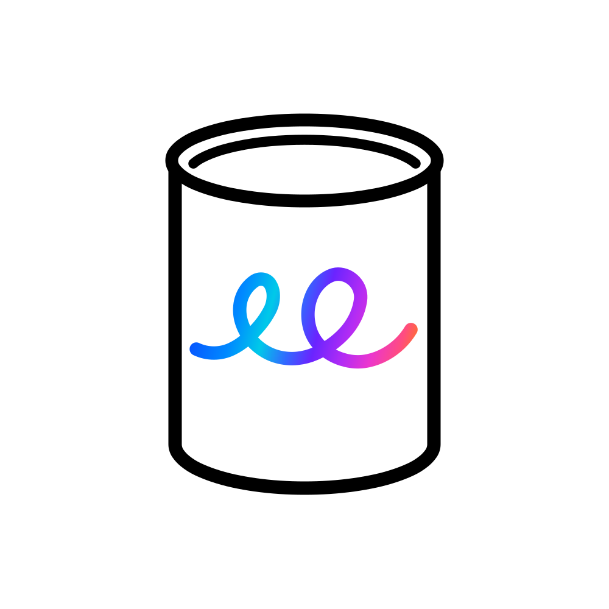
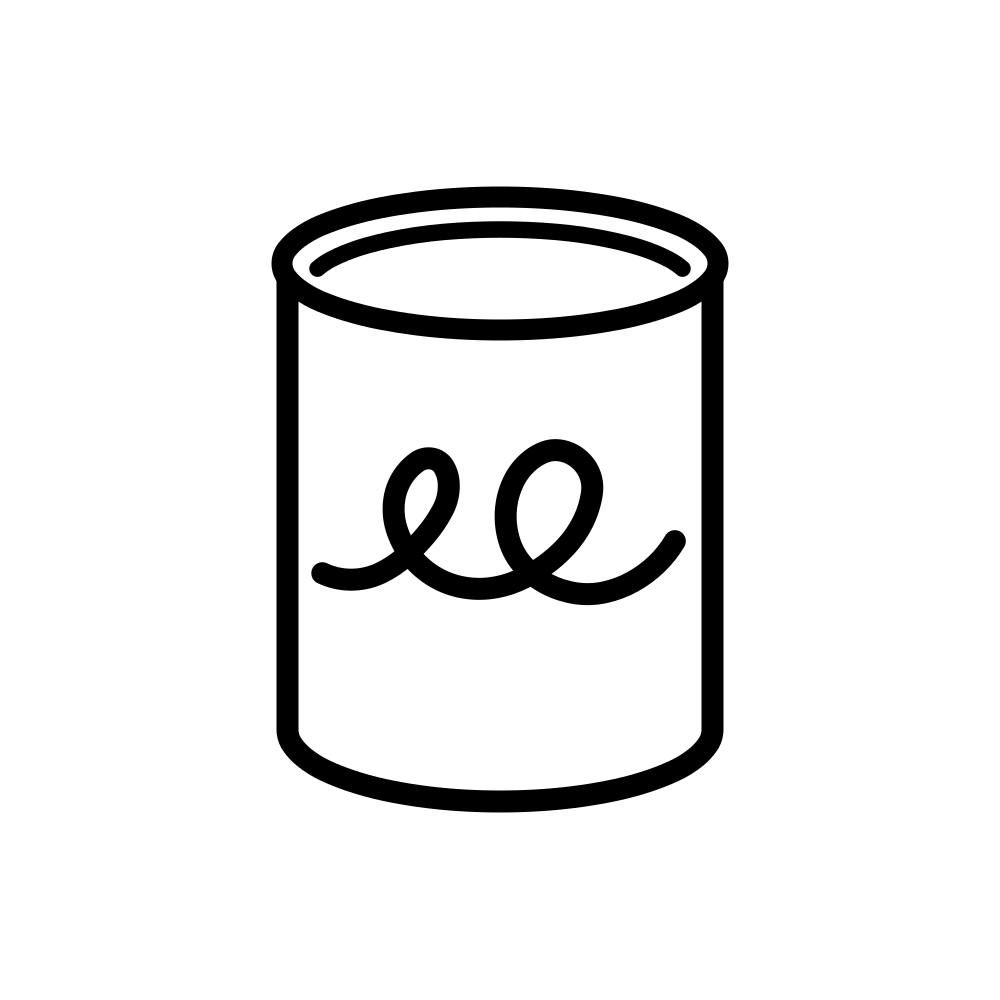

# Thinktin Logo · G1.0

 

2026 年 10 月 30 日定稿。标志采用白底、黑色罐体和无文字构图。彩色版将颜色集中在罐身中央的一条连续双圈线上，从左侧的蓝、青过渡到紫、粉和右侧的橙红。黑白版沿用同一套几何轮廓，双圈改为黑色。

## 文件怎么用

- **使用标志**　首选[彩色 SVG](thinktin-master-gradient.svg)。单色印刷用[黑白 SVG](thinktin-master-black.svg)。两个版本都是正方形画板，请等比缩放。
- **查看制图依据**　[七页尺规设计稿（PDF）](thinktin-construction-spec.pdf)列出尺寸和圆弧参数。[辅助线总图（SVG）](thinktin-construction.svg)可以放大查看每段圆弧对应的辅助圆。
- **精确复建**　[几何参数（JSON）](thinktin-geometry.json)记录四条路径的端点、圆心、半径、线宽和渐变色标。[圆弧表（CSV）](thinktin-arc-table.csv)便于逐段核对。

G1.0 将确认的图形整理为 96 段圆弧和 2 段直线。画板为 1000 × 1000 单位，原点在左上角。按参数可 1:1 复建这版矢量原稿。PDF 中的图形随版面缩放，手工制图请使用标注数值。

## 从参数生成 SVG

在本目录运行以下命令，需要 Python 3，仅使用标准库。

```sh
python3 rebuild.py thinktin-geometry.json rebuilt
```

`rebuilt/` 中会生成彩色、黑白、辅助线三份 SVG，以及圆弧表和几何校验结果。可用[原稿 SHA-256 清单](rebuild-verification.json)核对三份 SVG 和 CSV。其余尺寸、渐变轴及九个色标见[原包使用说明](README_使用说明.txt)。
