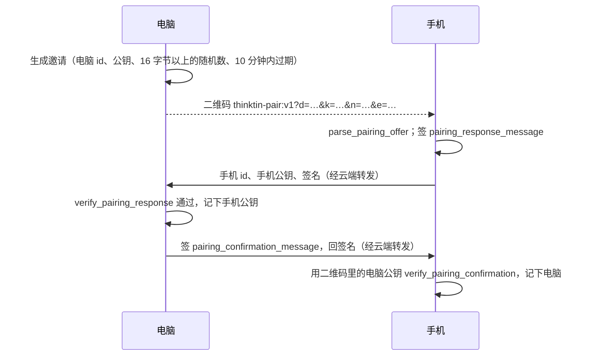

# 配对与验签协议（WBS 11.5）

手机控制电脑（架构方案第 7 节）用的三类签名消息：配对、审批、能力令牌。编码、解析、验签都在
`client-core`（`crates/client-core/src/pairing.rs`），手机和电脑两边用同一份实现，原生端经 UniFFI 调用。

## 1. 密钥

- 每台设备在安全芯片里生成自己的 **P-256** 密钥对：iOS / macOS 用 Secure Enclave，Android 用 Keystore（支持时用 StrongBox）。
  **私钥不出芯片**，每次签名都要生物识别。签名由原生端做，`client-core` 只给出要签的字节，并负责验签。
- 签名算法：**ECDSA P-256 + SHA-256**（签的是消息本身，由系统算 SHA-256）：
  - iOS：`SecKeyCreateSignature(key, .ecdsaSignatureMessageX962SHA256, data)`，或者 CryptoKit 的 `signature(for:)`；
  - Android：`Signature.getInstance("SHA256withECDSA")`。
- 签名格式：DER（上面两种系统接口的输出）和 64 字节的 r‖s 都接受；高 S 的签名会先规整成低 S 再验。
- 公钥格式：SEC1，压缩（33 字节）或不压缩（65 字节）都可以，传输时用**不带填充的 base64url**。
  `encode_public_key(sec1)` 会顺便检查它是不是合法的 P-256 公钥。

## 2. 配对

- 公钥只通过二维码（线下）和双方的签名交换，云端只负责转发，冒充不了任何一方。
- 邀请过期（允许两台设备的时钟差 5 分钟）、随机数对不上、签名对不上，都会拒绝。
- 换手机后旧设备的公钥作废，新设备要重新配对。

## 3. 审批（高危操作）

电脑上的删除、执行命令、发送、支付这类操作**不能预授权**，每次都要手机签名批准：

1. 电脑把 `ApprovalRequest` 经云端发给手机。字段有：电脑 id、请求 id、工具名、工具参数（JSON）、给人看的说明、签发时间、过期时间（最长 24 小时）。
2. 手机在审批界面显示说明，用户用生物识别解锁私钥后，签 `approval_message(request, approve)`。
3. 电脑用配对时记下的手机公钥 `verify_approval`，通过了才执行。

签的内容里有：

- 参数的摘要（`arguments_digest`：JSON 规范化后的 SHA-256，与键的顺序、空白无关），所以参数被改过就验不过；
- 说明的摘要，所以界面上显示的和电脑要执行的对得上；
- 决定（批准 / 拒绝），所以拒绝的签名不会被当成批准。

## 4. 能力令牌（普通操作）

手机签发 `CapabilityGrant`，电脑用 `verify_capability` 本地验，再用 `capability_allows_path` 检查路径。

- 令牌限定：电脑 id、令牌 id、能碰的目录（绝对路径，按路径段比较，`..` 一律拒绝）、能操作的应用（bundle id）、过期时间。
- 吊销：电脑按令牌 id 自己记一份吊销列表（以后由手机经中继推送吊销）。

## 5. 规范编码

所有要签的消息都是 UTF-8 文本：第一行写明种类和版本，后面每行一个 `键:值`。

- 种类是 `thinktin-pair-response-v1`、`thinktin-pair-confirm-v1`、`thinktin-approval-v1`、`thinktin-capability-v1` 之一，所以不同种类的签名不能互换。
- 值里不能有换行。
- 字段顺序固定，以代码为准。

测试向量由独立实现（Python `cryptography`，也就是 OpenSSL）按同一份规范生成，规范编码、参数摘要、DER 签名（随机 k，含高 S）都对得上（`pairing/tests.rs`）。原生端可以拿这些向量验证自己的签名接口。

## 6. 经平台转发的消息正文

手机和电脑之间的消息经 [设备中继](relay.md) 转发（`kind` 见 `proto::domain::DeviceMessageKind`），正文是 JSON，
类型在 `client_core::pairing` 里。签名一律是 base64url（不带填充）编码的 DER 或 r‖s。

| `kind` | 方向 | 正文 |
|---|---|---|
| `pair_response` | 手机 → 电脑 | `{"nonce": …, "phone_key": …, "signature": …}`，签的是 `pairing_response_message(offer, 发件设备 id, phone_key)`；电脑按 `nonce` 找到自己发出的邀请 |
| `pair_confirm` | 电脑 → 手机 | `{"nonce": …, "signature": …}`，签的是 `pairing_confirmation_message(offer, 手机 id, phone_key)`；手机用二维码里的电脑公钥验 |
| `capability` | 手机 → 电脑 | `{"grant": CapabilityGrant, "signature": …}`，签的是 `capability_message(grant)` |
| `revocation` | 手机 → 电脑 | `{"token_id": …}`，不用签名：吊销只会收紧权限，平台伪造了也只能让电脑少做事 |
| `approval_request` | 电脑 → 手机 | `{"request": ApprovalRequest}` |
| `approval_decision` | 手机 → 电脑 | `{"request_id": …, "approve": true/false, "signature": …}`，签的是 `approval_message(request, approve)` |

电脑只收配对的手机发来的令牌和吊销；令牌里的电脑 id 必须是自己。审批决定按请求 id 对上等着的请求，再用手机公钥验签。

## 7. 还没做的

- ~~设备中继（14.1）~~：已做，见 [设备中继](relay.md)。配对、审批、能力令牌、吊销消息经平台转发，
  收件方不在线时排队 24 小时；方向由平台检查（配对确认、审批请求只能电脑发）。电脑发来的审批请求推送到手机随审批界面做。
- ~~电脑端的工具服务（14.2）~~：已做，见 [电脑工具](desktop.md)。
- ~~手机这边（12.9、13.9）~~：已做。iOS 用 Secure Enclave（`SecureEnclaveSigner`），安卓用 Keystore / StrongBox
  （`KeystoreSigner`），每次签名都要生物识别；扫码配对、签名审批、签发和吊销能力令牌。
- 电脑这边的配对（14.8）：Rust 部分已做（`desktop` 的 `start_pairing`：出邀请、验手机的回复、签确认发回，测试经真的中继
  端到端走一遍）；Mac 上显示二维码、钥匙串里的电脑密钥随 macOS App。
- 吊销列表的推送和同步。
