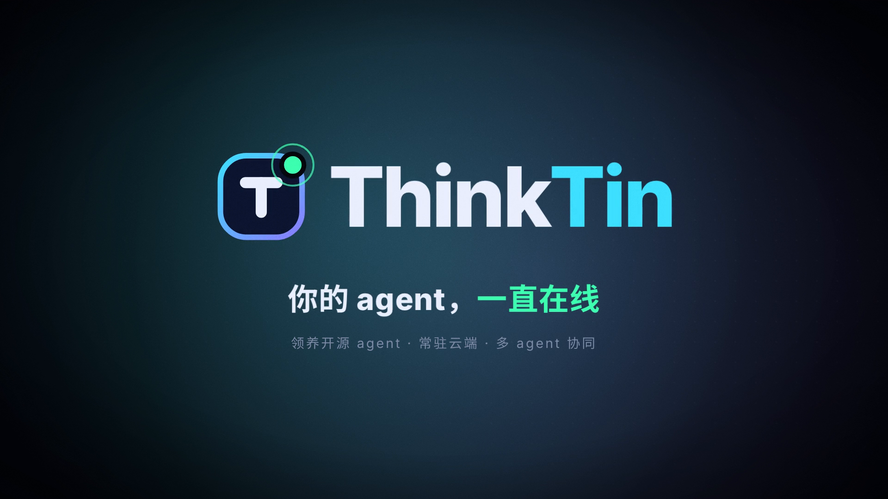

# ThinkTin 宣传片

20 秒，1920×1080，30fps，H.264 + AAC。成片：[`out/thinktin-promo.mp4`](out/thinktin-promo.mp4)，封面：[`out/poster.png`](out/poster.png)。



## 分镜

内容全部来自[架构方案 v3](../docs/architecture-v3.md)，不出现第三方产品的名称和标志（见方案 3.7）。

| 时间 | 镜头 | 画面 | 对应架构 |
| --- | --- | --- | --- |
| 0.0–3.5 | 01 常驻云端：你下线了，它还在干活 | 手机退出登录、锁屏；云端 agent 继续运行，时钟快进到 07:00，计划逐个触发，推送送达 | 编排服务、运行授权与登录会话分离（4.1、4.6、4.8） |
| 3.5–6.5 | 02 多 agent 协同：多个 agent，分工协作 | 编排服务调度一张 DAG：调研 → 编码 / 撰写 → 汇总，经产出物交接 | 团队、运行树、流水线与委派（4.11） |
| 6.5–10.0 | 03 强隔离：一个 agent，一台 microVM | 三个封闭的 microVM 互不相通；只带令牌出来，key 只在模型网关里换上 | CubeSandbox、BYOK、模型网关（5、6） |
| 10.0–13.0 | 04 手机控制电脑：手机下令，电脑执行 | agent 选中电脑上的文件 → 经设备中继回手机 → 指纹签名 → 电脑执行 | 设备中继、MCP 工具、高危操作签名（7） |
| 13.0–16.0 | 05 Rust 内核，三端原生 | iOS、Android、macOS 共用 Rust client-core（UniFFI）；仓库里的 16 个 crate 依次点亮 | 客户端分层、代码结构（8、10） |
| 16.0–20.0 | 落版：ThinkTin · 你的 agent，一直在线 | 标志、口号、核心卖点 | — |

## 怎么做的

画面是一个 HTML 页面，每一帧都是时间 `t` 的纯函数：`render.mjs` 用 Playwright 打开页面，逐帧调用 `window.renderFrame(t)` 截图，再经 ffmpeg 编码。配乐由 `music.py` 用 numpy 合成（120 BPM，一小节 2 秒，转场和落版的重击都卡在小节上）。

| 文件 | 作用 |
| --- | --- |
| `index.html` | 画面结构、文字、样式 |
| `timeline.js` | 分镜：每个镜头的图形和动画 |
| `engine.js` | 缓动、逐字出现、描边动画等工具；直接用浏览器打开 `index.html` 时是带进度条的预览播放器 |
| `music.py` | 合成配乐，输出 `out/music.wav` |
| `fonts.py` | 按片中用到的字符裁剪字体（Noto Sans SC、Inter、JetBrains Mono，均为 OFL 许可） |
| `render.mjs` | 逐帧渲染并编码 |
| `build.sh` | 一键生成 |

## 重新生成

需要 Node 18+、Python 3（numpy、fonttools、brotli）和 ffmpeg。

```bash
cd promo
./build.sh                              # 裁剪字体 → 合成配乐 → 渲染 → 导出封面
node render.mjs --stills 2,5,8.5,18     # 只导出几个时间点的静帧，方便改画面时看效果
```

改了文字要重新跑 `python3 fonts.py`，否则新字没有字形。改了镜头切换时间，要同步改 `timeline.js` 的 `CUT` 和 `music.py` 的 `CUES` / `LOGO`。
